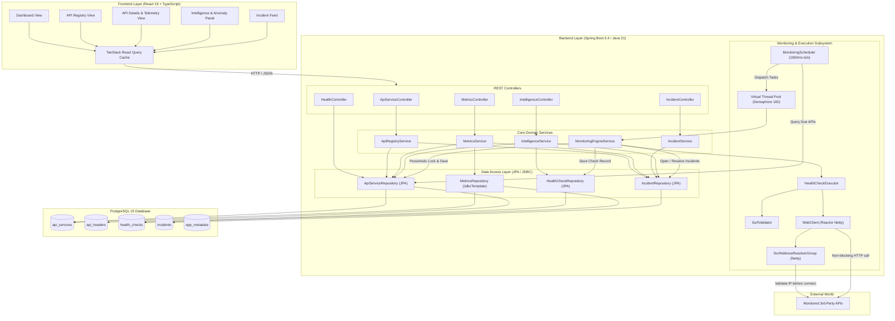
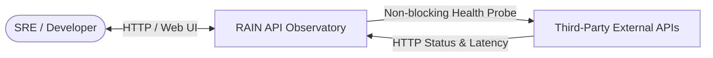
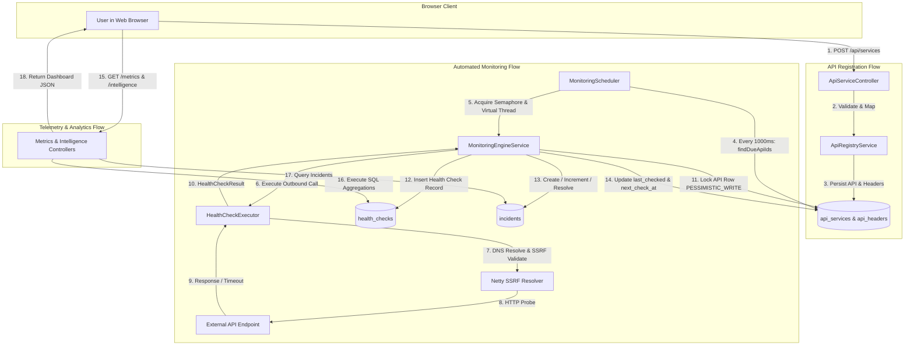
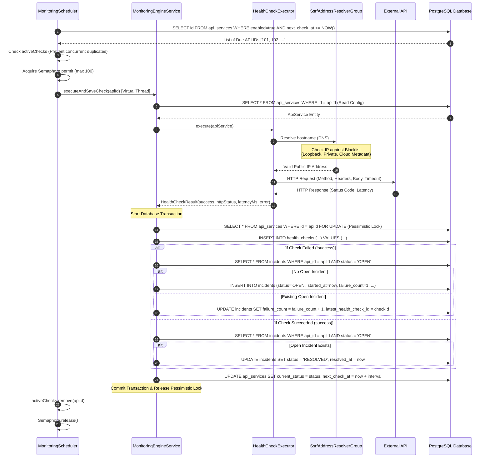
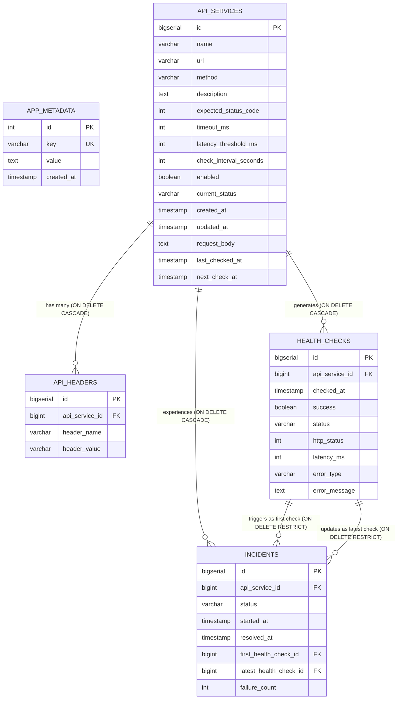

# High-Level Design (HLD)
## RAIN — Third-Party API Reliability Observatory

**Document Reference:** RAIN-DOC-HLD-001  
**Project:** RAIN API Observatory  
**Target Audience:** Kalvium University Project Assessor, Evaluation Panel, System Architects  
**Architecture Style:** Modular Monolith  
**Version:** 1.0.0  

---

## 1. System Architecture

### 1.1 Architectural Style: Modular Monolith
RAIN is architected as a **Modular Monolith**. Rather than adopting a microservices architecture—which introduces operational complexity, distributed transaction overhead, network latency between internal services, and eventual consistency challenges—RAIN encapsulates distinct business domains into strict, decoupled modules residing within a single deployable application artifact.

```
┌───────────────────────────────────────────────────────────────────────────┐
│                           REACT PRESENTATION LAYER                        │
│   (Vite, React 19, TypeScript, TanStack Query, Recharts, Tailwind CSS)    │
└─────────────────────────────────────┬─────────────────────────────────────┘
                                      │ HTTP / REST (JSON)
                                      ▼
┌───────────────────────────────────────────────────────────────────────────┐
│                       SPRING BOOT APPLICATION LAYER                       │
│  ┌───────────────────────┐ ┌───────────────────────┐ ┌─────────────────┐  │
│  │  API Registry Domain  │ │   Monitoring Domain   │ │ Telemetry Domain│  │
│  └───────────────────────┘ └───────────────────────┘ └─────────────────┘  │
│  ┌───────────────────────┐ ┌───────────────────────┐ ┌─────────────────┐  │
│  │    Incident Domain    │ │  Intelligence Domain  │ │ Security (SSRF) │  │
│  └───────────────────────┘ └───────────────────────┘ └─────────────────┘  │
└─────────────────────────────────────┬─────────────────────────────────────┘
                                      │ JDBC / JPA / HikariCP
                                      ▼
┌───────────────────────────────────────────────────────────────────────────┐
│                         POSTGRESQL STORAGE LAYER                          │
│               (PostgreSQL 15 Alpine, Flyway Database Migrations)          │
└───────────────────────────────────────────────────────────────────────────┘
```

### 1.2 Rationale for Architectural Choices
1. **Strong Consistency & ACID Transactions:** Health evaluation and incident state transitions demand absolute transactional boundaries. A single relational database enables PostgreSQL pessimistic write locks (`PESSIMISTIC_WRITE`) and partial unique indexes to eliminate duplicate open incidents without distributed locking engines (such as Redis/Redlock or ZooKeeper).
2. **Simplified Operational Footprint:** A single containerized database paired with a Spring Boot JAR delivers maximum developer productivity, straightforward local setup, and rapid continuous integration testing.
3. **High-Throughput I/O with Virtual Threads:** The execution of outbound network calls does not block operating system platform threads. Java 21 Virtual Threads (`Executors.newVirtualThreadPerTaskExecutor()`) permit hundreds of concurrent outbound health checks with minimal memory overhead.
4. **Decoupled Module Boundaries:** Each domain possesses its own entities, repositories, and services. Modules communicate via direct service interfaces without leaking internal transactional states.

---

## 2. Technology Stack

### 2.1 Technology Stack Summary Table

| Layer | Component | Version | Role & Justification |
|---|---|---|---|
| **Frontend** | React | 19.3.0 | Modern declarative UI library using functional components and hooks. |
| | TypeScript | 6.0.2 | Compile-time static type safety and DTO contract adherence. |
| | Vite | 8.3.0 | Next-generation bundler with instant Hot Module Replacement (HMR). |
| | TanStack Query | 5.103.2 | Asynchronous server state management, caching, and 30s background refetching. |
| | Recharts | 3.10.1 | Composable SVG-based chart library for latency and availability visualization. |
| | Tailwind CSS | 3.4.19 | Utility-first styling enabling a clean, modern SRE observatory aesthetic. |
| | Lucide React | 1.47.0 | Consistent icon library for observability indicators and statuses. |
| **Backend** | Java | 21 (LTS) | Modern Java runtime utilizing Project Loom Virtual Threads for scalable concurrency. |
| | Spring Boot | 3.4.0 | Core enterprise application framework providing dependency injection and auto-configuration. |
| | Spring MVC | 3.4.0 | Synchronous servlet stack for exposing clean, structured REST APIs. |
| | Spring Data JPA | 3.4.0 | Object-Relational Mapping (Hibernate 6) for domain entity persistence. |
| | Spring WebFlux / Reactor Netty | 3.4.0 | Reactive HTTP client (`WebClient`) used for non-blocking outbound health check requests. |
| | Flyway Core | 10.x | Version-controlled, idempotent database schema migrations. |
| **Database** | PostgreSQL | 15 (Alpine) | Robust relational database supporting advanced SQL analytics (`PERCENTILE_CONT`, `FILTER`). |
| **Infrastructure** | Docker Compose | 3.8 Spec | Orchestration for local containerized PostgreSQL instance with automated health checks. |

---

## 3. Major Components & Responsibilities



### 3.1 Component Breakdown

#### 1. API Registry Component
- **Package:** `com.rain.controller.ApiServiceController`, `com.rain.service.ApiRegistryService`
- **Responsibilities:**
  - Manages API registration, configuration updates, deletion, pausing, and resuming.
  - Enforces URL validation (valid URI scheme, hostname validation).
  - Sanitizes sensitive request headers before returning metadata to clients.
  - Cross-references active incidents to return `hasActiveIncident` flags.

#### 2. Monitoring Scheduler & Concurrency Dispatcher
- **Package:** `com.rain.monitoring.MonitoringScheduler`
- **Responsibilities:**
  - Runs periodically at a fixed delay of 1,000ms (`@Scheduled`).
  - Evaluates database state to find APIs with `next_check_at <= NOW()`.
  - Enforces duplicate in-flight prevention using a concurrent set (`activeChecks`).
  - Throttles concurrent executions using a `Semaphore` (maximum 100 concurrent workers).
  - Submits executions to Java 21 Virtual Threads (`Executors.newVirtualThreadPerTaskExecutor()`).

#### 3. Health Check Executor & SSRF Protection
- **Package:** `com.rain.monitoring.HealthCheckExecutor`, `SsrfValidator`, `SsrfAddressResolverGroup`
- **Responsibilities:**
  - Constructs outbound HTTP requests using reactive `WebClient` with custom headers and bodies.
  - Measures round-trip execution latency via high-resolution timers (`System.nanoTime()`).
  - Implements DNS-level validation via Netty's `AddressResolverGroup`, blocking private/loopback/cloud-metadata IP addresses before TCP handshake.
  - Enforces `followRedirect(false)` to prevent open-redirect SSRF bypasses.
  - Maps exceptions into categorized error types (`TIMEOUT`, `CONNECTION_REFUSED`, `DNS_ERROR`, `SSRF_BLOCKED`).

#### 4. Monitoring Engine & Incident Lifecycle Service
- **Package:** `com.rain.monitoring.MonitoringEngineService`, `com.rain.service.IncidentService`
- **Responsibilities:**
  - Evaluates check results against configured expected status codes and latency thresholds (`HEALTHY`, `DEGRADED`, `DOWN`).
  - Executes isolated transactional persistence via self-injected Spring AOP proxy (`@Transactional`).
  - Acquires pessimistic write lock (`@Lock(LockModeType.PESSIMISTIC_WRITE)`) on the target API row.
  - Manages incident lifecycle: creates a new `OPEN` incident on first failure, increments `failureCount` on sustained failure, and resolves the incident upon recovery.
  - Schedules the next execution timestamp: `nextCheckAt = checkedAt + checkIntervalSeconds`.

#### 5. Telemetry & Analytics Engine
- **Package:** `com.rain.monitoring.MetricsService`, `com.rain.repository.MetricsRepository`
- **Responsibilities:**
  - Executes high-performance SQL analytics via Spring `JdbcTemplate`.
  - Calculates check-based uptime percentage, failure rate, average latency, and P95 latency.
  - Performs time-series aggregation using PostgreSQL native `date_trunc` with UTC time bucketing.
  - Powers dashboard summaries across 1h, 6h, 24h, 7d, and 30d time horizons.

#### 6. Intelligence & Anomaly Engine
- **Package:** `com.rain.intelligence.IntelligenceService`, `com.rain.intelligence.IntelligenceController`
- **Responsibilities:**
  - Computes composite 0–100 reliability scores based on 70% availability and 30% latency compliance.
  - Evaluates performance trends (`IMPROVING`, `STABLE`, `DECLINING`) against historical baselines.
  - Runs statistical anomaly detection ($\mu + 3\sigma$) on latency data points.
  - Identifies predominant error types and computes Mean Time to Recovery (MTTR).
  - Synthesizes automated root cause diagnostic hints.

#### 7. Presentation Layer (React SPA)
- **Package:** `frontend/src/`
- **Responsibilities:**
  - Displays real-time operational dashboard with auto-polling every 30 seconds.
  - Renders Recharts-powered interactive latency and success/failure distribution graphs.
  - Facilitates API service onboarding with comprehensive input validation.
  - Renders incident audit logs and intelligence diagnostic cards.

---

## 4. Data Flow Diagrams (DFD)

### 4.1 DFD Level 0: Context Diagram



### 4.2 DFD Level 1: System Workflow Diagram



### 4.3 Outbound Health Check & Incident Evaluation Flow



---

## 5. Database Architecture & ER Diagram

### 5.1 Relational Schema Design
The relational database layer is managed through **Flyway version-controlled migrations** in `backend/src/main/resources/db/migration/`:
- `V1__init.sql`: Creates `app_metadata` table for platform version tracking.
- `V2__create_api_registry.sql`: Creates core `api_services` table and dependent `api_headers` table.
- `V3__monitoring_engine_schema.sql`: Adds execution columns (`request_body`, `last_checked_at`, `next_check_at`) to `api_services`, creates `health_checks` table and `idx_health_checks_api_id`.
- `V4__telemetry_metrics_index.sql`: Adds time-range query index `idx_health_checks_checked_at`.
- `V5__incident_engine_schema.sql`: Creates `incidents` table, indexes on `(api_service_id, status)` and `(started_at DESC)`, and the partial unique index `uq_incidents_one_open_per_api`.

### 5.2 Entity-Relationship (ER) Diagram



### 5.3 Critical Constraints & Indexes

1. **Partial Unique Index on Incidents:**
   ```sql
   CREATE UNIQUE INDEX uq_incidents_one_open_per_api
   ON incidents(api_service_id)
   WHERE status = 'OPEN';
   ```
   *Guarantees at the database engine level that no race condition can ever produce duplicate active incidents for an API.*

2. **Compound Index on Health Checks:**
   ```sql
   CREATE INDEX idx_health_checks_api_id ON health_checks(api_service_id, checked_at DESC);
   ```
   *Optimizes retrieval of historical checks, latest checks, and baseline calculations.*

3. **Global Timestamp Index:**
   ```sql
   CREATE INDEX idx_health_checks_checked_at ON health_checks(checked_at);
   ```
   *Enables high-speed time-bucketed aggregation for global dashboard telemetry.*

---

## 6. Deployment Architecture

### 6.1 Container & Host Topology

```
┌───────────────────────────────────────────────────────────────────────────┐
│                               HOST MACHINE                                │
│                                                                           │
│   ┌──────────────────────────┐             ┌──────────────────────────┐   │
│   │   Frontend Dev Server    │             │   Spring Boot Backend    │   │
│   │   (Vite / Node.js)       │             │   (Java 21 JVM)          │   │
│   │   Port: 5173             │             │   Port: 8080             │   │
│   └─────────────┬────────────┘             └─────────────┬────────────┘   │
│                 │ Vite Proxy (/api)                      │                │
│                 └────────────────────────────────────────┘                │
│                                                          │ JDBC (5432)    │
│                                                          ▼                │
│   ┌───────────────────────────────────────────────────────────────────┐   │
│   │   Docker Engine (docker-compose)                                  │   │
│   │   ┌───────────────────────────────────────────────────────────┐   │   │
│   │   │   Container: rain_postgres                                │   │   │
│   │   │   Image: postgres:15-alpine                               │   │   │
│   │   │   Internal Port: 5432  <===>  Host Port: 5432             │   │   │
│   │   │   Volume: postgres_data -> /var/lib/postgresql/data       │   │   │
│   │   │   Healthcheck: pg_isready -U rain_user -d rain_db         │   │   │
│   │   └───────────────────────────────────────────────────────────┘   │   │
│   └───────────────────────────────────────────────────────────────────┘   │
└───────────────────────────────────────────────────────────────────────────┘
```

### 6.2 Configuration & Environment Variables

| Variable Name | Default Value | Description |
|---|---|---|
| `POSTGRES_DB` | `rain_db` | PostgreSQL database name inside Docker. |
| `POSTGRES_USER` | `rain_user` | Database master username. |
| `POSTGRES_PASSWORD` | `rain_password` | Database master password. |
| `DATABASE_URL` | `jdbc:postgresql://localhost:5432/rain_db` | Spring Boot JDBC connection string. |
| `DATABASE_USERNAME` | `rain_user` | Spring datasource connection user. |
| `DATABASE_PASSWORD` | `rain_password` | Spring datasource connection password. |
| `FRONTEND_URL` | `http://localhost:5173` | Allowed origin for frontend clients. |
| `rain.monitoring.dispatcher-interval` | `1000` | Scheduler polling interval in milliseconds. |
| `rain.monitoring.max-concurrency` | `100` | Maximum simultaneous outbound health checks. |
