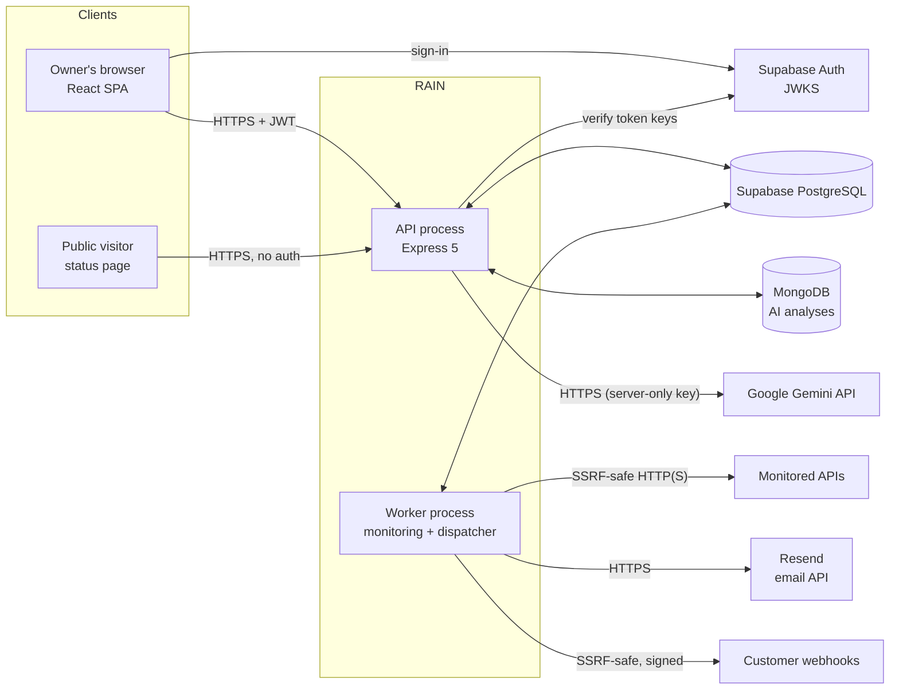
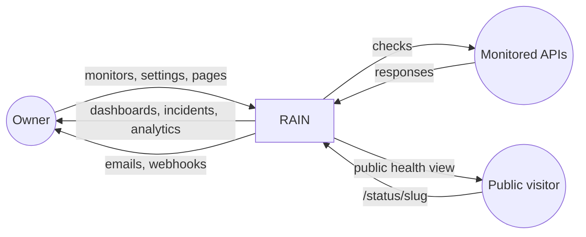
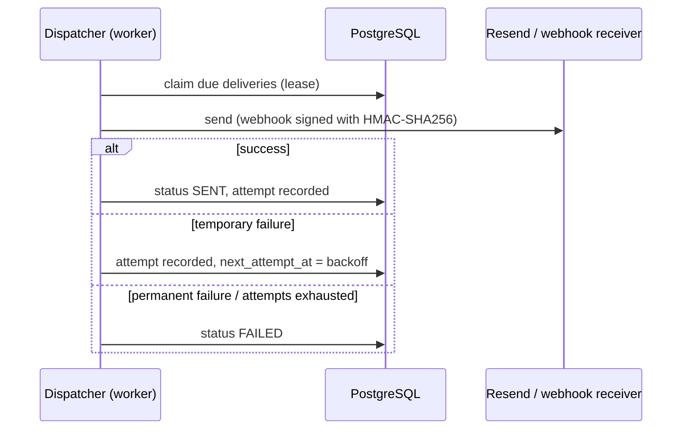
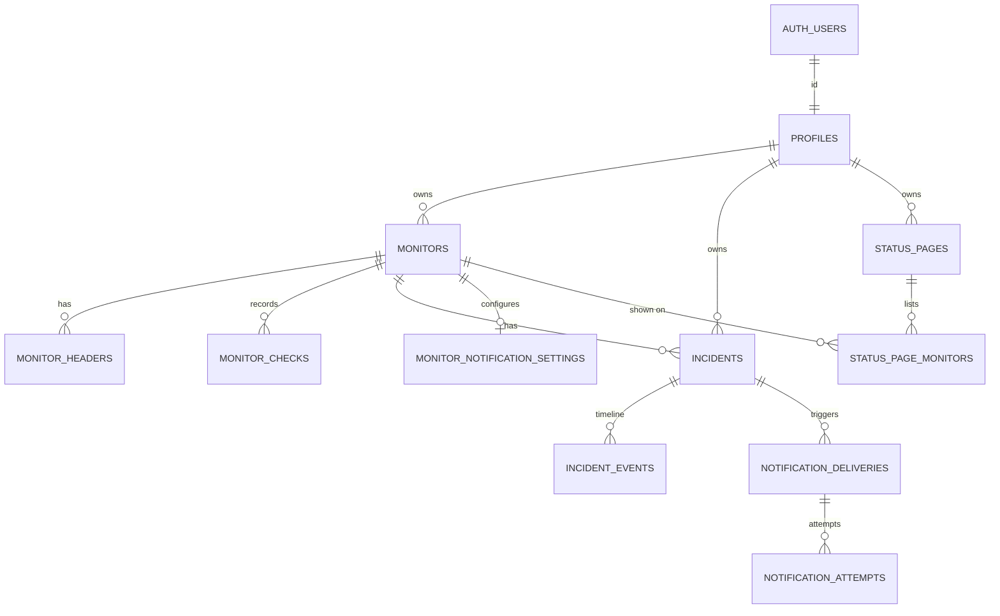
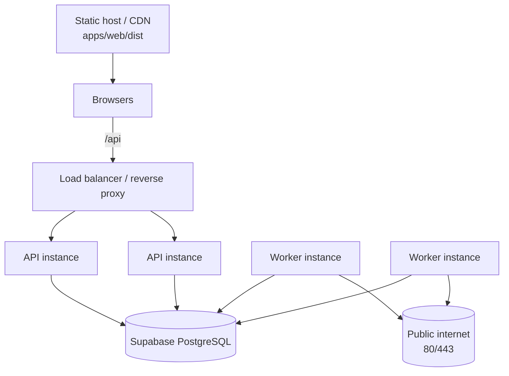

# High-Level Design (HLD)

## RAIN — API Observatory

Related: [Product Requirements](PRD.md) · [Low-Level Design](LLD.md) ·
[Deployment guide](deployment.md)

---

## 1. System Architecture

### 1.1 Architectural Style

RAIN is a **modular monolith split into two processes** that share one codebase and one database:

- **API process** (`apps/server/src/api.ts`) — stateless Express 5 HTTP API.
- **Worker process** (`apps/server/src/worker.ts`) — runs the monitoring loop and the
  notification dispatcher.
- **Web app** (`apps/web`) — a React single-page app served as static files.
- **Shared contracts** (`packages/shared`) — Zod schemas and types used by both sides.

PostgreSQL is the only durable state and the only coordination mechanism between processes: there is
no message broker, cache or in-memory queue.



### 1.2 Rationale

| Decision                                     | Why                                                                                         |
| -------------------------------------------- | ------------------------------------------------------------------------------------------- |
| API and worker as separate processes         | Outbound checks never compete with request handling; each scales independently.             |
| PostgreSQL as the queue                      | `FOR UPDATE SKIP LOCKED` leases give safe multi-worker claims without extra infrastructure. |
| Transactional outbox for notifications       | An incident and its notifications commit together; delivery happens later, with retries.    |
| Supabase Auth, local JWT verification        | No session store; the API verifies tokens with cached JWKS keys.                            |
| Shared Zod package                           | One definition of every request/response shape, validated on both client and server.        |
| No HTTP request made inside a DB transaction | Short transactions; slow APIs can't hold locks.                                             |

---

## 2. Technology Stack

| Layer         | Technology                                                                 |
| ------------- | -------------------------------------------------------------------------- |
| Runtime       | Node.js 26, TypeScript (strict), npm workspaces                            |
| API           | Express 5, Zod 4, jose (JWT), Helmet, express-rate-limit, pino / pino-http |
| Database      | Supabase PostgreSQL, Drizzle ORM, postgres.js, drizzle-kit migrations      |
| Outbound HTTP | undici with a custom SSRF-safe dispatcher (DNS validation, IP pinning)     |
| Email         | Resend REST API                                                            |
| Web           | React 19, Vite, React Router, TanStack Query, Tailwind CSS 4, Radix UI     |
| Auth          | Supabase Auth (email/password), access tokens verified by the API          |
| Tests         | Vitest, Testing Library, Supertest, Testcontainers (PostgreSQL)            |

---

## 3. Components and Responsibilities

| Component         | Location                                       | Responsibility                                                             |
| ----------------- | ---------------------------------------------- | -------------------------------------------------------------------------- |
| HTTP app          | `apps/server/src/app.ts`                       | Middleware order, security headers, CORS, body limits, routing, errors     |
| Auth              | `apps/server/src/auth`                         | Bearer token verification, `req.user`                                      |
| Monitors          | `apps/server/src/monitors`                     | CRUD, URL safety, encryption of secrets, pause/resume, Check Now, history  |
| Monitoring engine | `apps/server/src/monitoring`                   | Claiming, executing, classifying, health state, incident rules, scheduling |
| Safe transport    | `apps/server/src/monitoring/safe-transport.ts` | DNS validation, address pinning, TLS, redirect refusal                     |
| Incidents         | `apps/server/src/incidents`                    | Listing, counts, detail, timeline, acknowledge, edit, PG JOIN context      |
| AI analysis       | `apps/server/src/ai`                           | Versioned prompt, Gemini REST adapter, Mongoose CRUD, advisory history     |
| Analytics         | `apps/server/src/analytics`                    | Windows, SQL aggregates, percentiles, time-series buckets                  |
| Notifications     | `apps/server/src/notifications`                | Settings, outbox rows, dispatcher, email and webhook senders, retry policy |
| Status pages      | `apps/server/src/status-pages`                 | Management API, public view generation, public rate-limited router         |
| Crypto            | `apps/server/src/crypto/secret-box.ts`         | AES-256-GCM with versioned keys                                            |
| Shared contracts  | `packages/shared/src`                          | Schemas, limits, enums, labels                                             |
| Web app           | `apps/web/src`                                 | Screens, data fetching and caching, forms, charts                          |

---

## 4. Data Flow

### 4.1 Context (DFD level 0)



### 4.2 Request path (owner)

1. The browser signs in with Supabase Auth and receives an access token.
2. Each API call sends `Authorization: Bearer <token>`.
3. The API verifies the token, ensures the user's profile row, validates the body with the shared
   schema, and runs the service method scoped to `owner_id = user.id`.
4. TanStack Query caches results in the browser; health views refetch periodically.

### 4.3 Check, health and incident flow

```mermaid
sequenceDiagram
  autonumber
  participant W as Worker
  participant DB as PostgreSQL
  participant T as Monitored API
  W->>DB: claim due monitors (FOR UPDATE SKIP LOCKED, lease token, lease_until)
  W->>DB: load encrypted headers
  W->>T: request via SSRF-safe transport (no transaction open)
  T-->>W: response / timeout / error
  W->>W: classify SUCCESS / DEGRADED / FAILURE
  W->>DB: BEGIN
  W->>DB: verify lease token, insert check (unique attempt_id)
  W->>DB: update health counters, status, next_check_at; clear lease
  W->>DB: open or resolve incident + timeline event
  W->>DB: queue notification deliveries (outbox)
  W->>DB: COMMIT
```

### 4.4 Notification flow



### 4.5 Public status page

The public router (`/api/v1/public/status-pages/:slug`) is mounted **before** authentication. It
reads only published pages, builds a view with generated text (no IDs, URLs or internal names) and
responds with `Cache-Control: no-store` and `X-Robots-Tag: noindex`, rate limited per IP.

---

## 5. Database Architecture

### 5.1 Schema overview

Eleven application tables in the `public` schema, all with Row Level Security enabled and no
policies (only the API's database role can read or write them). Supabase owns `auth.users`.

### 5.2 Entity-relationship diagram



### 5.3 Key constraints and indexes

| Constraint / index                              | Purpose                                                 |
| ----------------------------------------------- | ------------------------------------------------------- |
| `monitors_due_idx`, `monitors_manual_queue_idx` | Fast claiming of due and manually requested checks      |
| `monitors_lease_complete` check                 | Lease token and expiry are set or cleared together      |
| `monitor_checks_attempt_id_uq`                  | A check attempt is recorded at most once                |
| `incidents_one_active_per_monitor_uq` (partial) | At most one OPEN/ACKNOWLEDGED incident per monitor      |
| `incident_events` trigger                       | Timeline is append-only (no update/delete)              |
| `notification_deliveries_event_channel_uq`      | One delivery per event and channel (outbox idempotency) |
| `status_page_monitors_same_owner` trigger       | A page can only list its owner's monitors               |
| `status_pages_slug_uq`                          | Globally unique public addresses                        |

---

## 6. Security Architecture

| Layer          | Control                                                                                                                        |
| -------------- | ------------------------------------------------------------------------------------------------------------------------------ |
| Edge           | Helmet headers, CORS allow-list, 256 KB JSON body limit, rate limits                                                           |
| Identity       | Supabase JWT verified locally (issuer, audience, signature); anon/service tokens rejected                                      |
| Authorization  | Owner scoping in every query; 404 for other users' resources                                                                   |
| Data at rest   | AES-256-GCM for secrets with key versions and rotation                                                                         |
| Database       | RLS on all tables, constraints and triggers for invariants                                                                     |
| Outbound       | SSRF defence: URL rules at registration and execution, DNS validation and pinning at connect, no redirects, response size caps |
| Logging        | pino with redaction of auth headers and secret fields; DB errors logged without parameters                                     |
| Public surface | Minimal public contract, no-store, noindex, bidi-character rejection                                                           |

Details: [monitor network security](security/monitor-network-security.md).

---

## 7. Deployment Architecture

### 7.1 Topology



- API instances are stateless; set `TRUST_PROXY` to the number of proxy hops.
- Worker instances can be added freely; leases prevent double-checking.
- Workers need direct outbound access to the internet on ports 80/443 and to `api.resend.com`, and
  should be network-isolated from internal services and cloud metadata endpoints.

### 7.2 Configuration

All configuration is environment variables, validated at startup (process exits with a list of
problems, never values). See [`.env.example`](../.env.example) and [deployment.md](deployment.md).

### 7.3 Health and lifecycle

- `GET /healthz` — liveness; `GET /readyz` — database and auth keys reachable (503 otherwise).
- Graceful shutdown: the API drains connections (10 s cap); the worker stops claiming and waits up
  to `WORKER_SHUTDOWN_GRACE_MS` for in-flight work. Unfinished leases simply expire.
