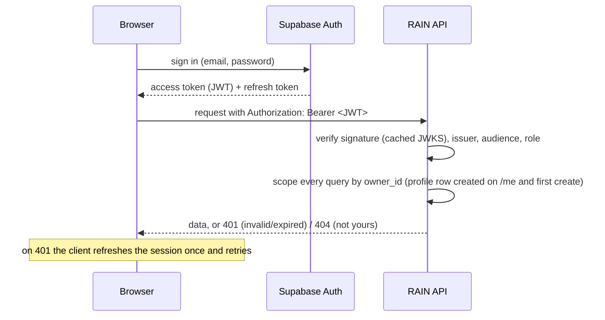
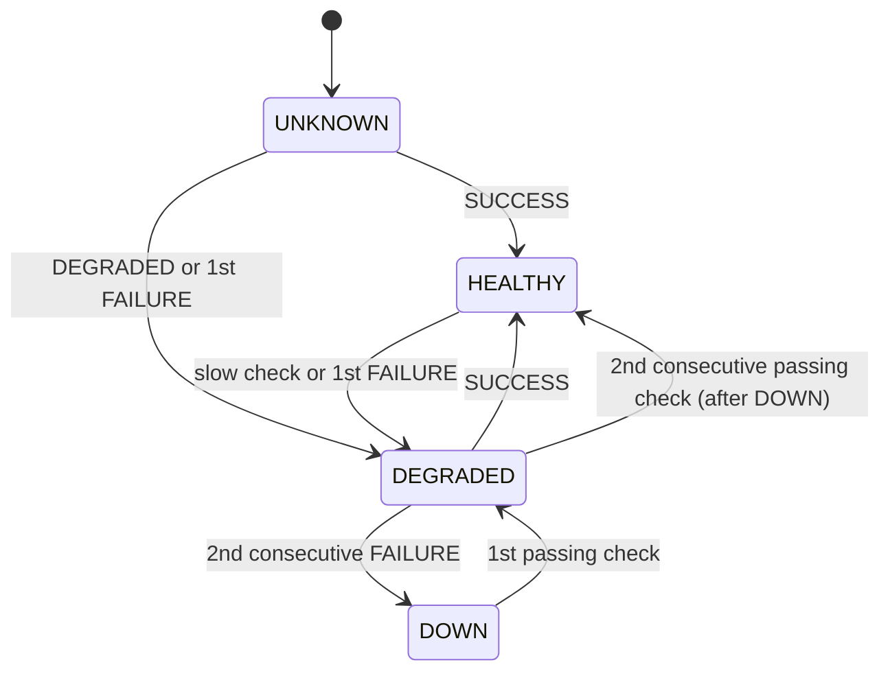
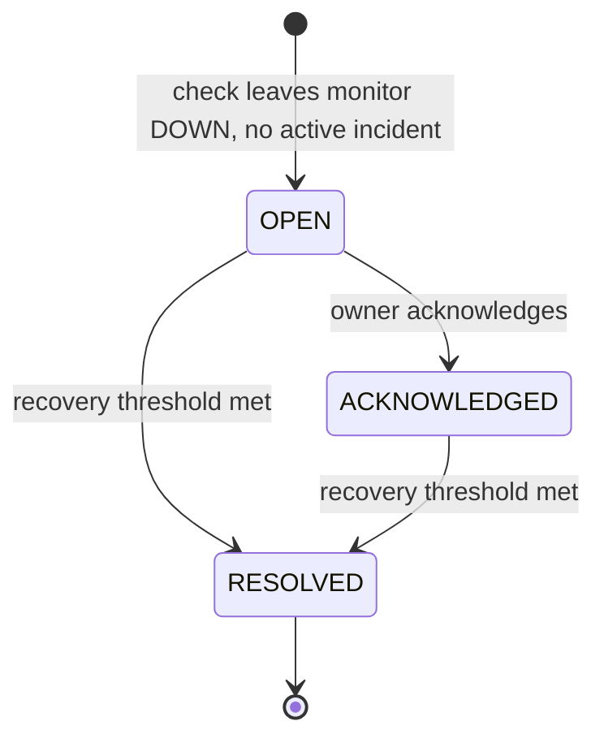

# Low-Level Design (LLD)

## RAIN — API Observatory

Related: [Product Requirements](PRD.md) · [High-Level Design](HLD.md)

---

## 1. Project Folder Structure

```
apps/
  server/
    drizzle/                 SQL migrations 0000–0007 (+ meta journal)
    src/
      api.ts                 API process entry: config, DB pool, HTTP server, graceful shutdown
      worker.ts              Worker process entry: monitoring worker + notification dispatcher
      app.ts                 Express app: middleware order and routers
      config.ts              Environment parsing and validation
      auth/                  verify-token.ts (jose), require-auth.ts
      crypto/secret-box.ts   AES-256-GCM with versioned keys
      db/                    schema.ts (Drizzle), client.ts, profiles.ts
      http/                  request-id.ts, error-handler.ts
      monitors/              routes, service, repository, cursor pagination, secret contexts
      monitoring/            executor, safe-transport, health, incident-rules, completion,
                             schedule, monitoring-store (PostgreSQL), worker-engine
      incidents/             routes, service, repository (incl. multi-table SQL JOIN context)
      ai/                    Gemini adapter, prompt builder, Mongoose model, CRUD repository, routes
      analytics/             routes, service, repository, analytics-window
      examples/              isolated educational JS fundamentals (hoisting, promises vs callbacks)
      notifications/         routes, service, repository, outbox, rules, dispatcher,
                             dispatch-store, email (Resend), webhook-sender
      status-pages/          routes (private + public), service, repository, public-status
      routes/                health.ts (/healthz, /readyz), me.ts
      test-support/          in-memory stores, fakes, fixtures (tests only; lint-guarded)
  web/
    index.html               App entry; harness.html is a dev-only UI harness
    src/
      app.tsx, main.tsx, router.tsx
      auth/                  Supabase session provider, route guards
      components/            app shell, page scaffolding, UI primitives (ui/)
      features/              monitors, incidents, analytics, notifications, status-pages
      lib/                   api-client (typed fetch + Zod), query client, Supabase client
      pages/                 overview, login, register, password reset, errors
      test-support/          fake API, render helpers, harness (never in the production build)
packages/
  shared/src/                Zod schemas, enums, limits shared by server and web
tests/
  integration/               PostgreSQL integration suites (Testcontainers or *_test DB)
docs/                        PRD, HLD, LLD, feature guides, security, deployment
```

---

## 2. Module Descriptions

### 2.1 Server

| Module          | Key files                                                          | Notes                                                                                                                   |
| --------------- | ------------------------------------------------------------------ | ----------------------------------------------------------------------------------------------------------------------- |
| App composition | `app.ts`                                                           | Request ID → Helmet → CORS → JSON (256 KB) → health → public router → auth → rate limit → routers → 404 → error handler |
| Auth            | `auth/verify-token.ts`                                             | Verifies issuer, audience, signature (JWKS; optional legacy HS256)                                                      |
| Monitors        | `monitors/monitor-service.ts`                                      | Validation, URL safety, encryption, quota, origin-change rule, Check Now cooldown                                       |
| Executor        | `monitoring/executor.ts`                                           | Builds the request, enforces method/body policy, classifies results                                                     |
| Safe transport  | `monitoring/safe-transport.ts`                                     | undici dispatcher with validated, pinned DNS and TLS                                                                    |
| Health          | `monitoring/health.ts`                                             | Pure state machine for status and counters                                                                              |
| Incident rules  | `monitoring/incident-rules.ts`                                     | Pure decision: open / resolve / nothing                                                                                 |
| Completion      | `monitoring/completion.ts`, `monitoring-store.ts`                  | One transaction per check result                                                                                        |
| Worker engine   | `monitoring/worker-engine.ts`                                      | Poll loop, concurrency, backoff on DB errors, graceful stop                                                             |
| Analytics       | `analytics/analytics-repository.ts`                                | SQL aggregates, `percentile_cont`, `date_bin` buckets                                                                   |
| Notifications   | `notifications/*`                                                  | Outbox insert in completion transaction; dispatcher with leases                                                         |
| Status pages    | `status-pages/*`                                                   | Owner management; public view builder (`public-status.ts`)                                                              |
| Errors and logs | `errors.ts`, `http/error-handler.ts`, `safe-error.ts`, `logger.ts` | Typed `AppError`s, JSON error body, redacted logs                                                                       |

### 2.2 Web

| Module                                     | Notes                                                                                                                       |
| ------------------------------------------ | --------------------------------------------------------------------------------------------------------------------------- |
| `lib/api-client`                           | Adds the bearer token, refreshes once on 401, parses responses with shared Zod schemas, surfaces `ApiError` with request ID |
| `auth/`                                    | Supabase session state; guards for signed-in and signed-out routes                                                          |
| `features/*/api.ts`                        | TanStack Query hooks and query keys per feature; periodic refetch for health data                                           |
| `components/`                              | App shell (sidebar, header), page header, empty/error states, cards, tables, dialogs                                        |
| `features/analytics/time-series-chart.tsx` | Dependency-free SVG charts with tooltips and data tables                                                                    |

Web routes: `/login`, `/register`, `/forgot-password`, `/reset-password`, `/app` (overview),
`/app/monitors`, `/app/monitors/new`, `/app/monitors/:monitorId`, `/app/monitors/:monitorId/edit`,
`/app/incidents`, `/app/incidents/:incidentId`, `/app/analytics`, `/app/notifications`,
`/app/notifications/:notificationId`, `/app/status-pages`, `/app/status-pages/:statusPageId`,
`/app/status-pages/:statusPageId/preview`, and the public `/status/:slug`.

---

## 3. Database Tables

All timestamps are `timestamptz`. All tables have RLS enabled with no policies.

### 3.1 `profiles`

| Column                     | Type        | Notes                             |
| -------------------------- | ----------- | --------------------------------- |
| `id`                       | uuid PK     | = `auth.users.id`, cascade delete |
| `display_name`             | text        | nullable                          |
| `created_at`, `updated_at` | timestamptz |                                   |

### 3.2 `monitors`

| Column                                              | Type               | Notes                                                   |
| --------------------------------------------------- | ------------------ | ------------------------------------------------------- |
| `id`                                                | uuid PK            |                                                         |
| `owner_id`                                          | uuid FK            | → `profiles`, cascade                                   |
| `name`, `description`                               | varchar(100), text |                                                         |
| `url`, `method`                                     | varchar            | method ∈ GET, HEAD, OPTIONS, POST, PUT, PATCH (checked) |
| `expected_status_code`                              | int                |                                                         |
| `timeout_ms`, `latency_threshold_ms`                | int                | 1000–30000; threshold ≤ timeout                         |
| `check_interval_seconds`                            | int                | 60–86400                                                |
| `request_body_ciphertext/iv/auth_tag/key_version`   | text/int           | encrypted body (≤ 32 KB plaintext)                      |
| `body_content_type`                                 | varchar            |                                                         |
| `allow_mutating_requests`                           | bool               | consent for POST/PUT/PATCH                              |
| `enabled`                                           | bool               | false = paused                                          |
| `current_status`                                    | varchar            | UNKNOWN / HEALTHY / DEGRADED / DOWN                     |
| `consecutive_failures`, `consecutive_successes`     | int                |                                                         |
| `status_changed_at`, `last_checked_at`              | timestamptz        |                                                         |
| `next_check_at`                                     | timestamptz        | scheduling                                              |
| `lease_until`, `lease_token`                        | timestamptz, uuid  | set together (check constraint)                         |
| `manual_check_requested_at`, `last_manual_check_at` | timestamptz        | Check Now queue and cooldown                            |

Indexes: owner, owner+created (pagination), due checks, manual queue.

### 3.3 `monitor_headers`

`id`, `monitor_id` (FK cascade), `header_name`, `value_ciphertext`, `value_iv`, `value_auth_tag`,
`encryption_key_version`. Unique on `(monitor_id, lower(header_name))`; max 20 per monitor.

### 3.4 `monitor_checks`

| Column                      | Notes                                                                                                                       |
| --------------------------- | --------------------------------------------------------------------------------------------------------------------------- |
| `monitor_id`                | FK cascade                                                                                                                  |
| `checked_at`                | when the request was made                                                                                                   |
| `source`                    | SCHEDULED or MANUAL                                                                                                         |
| `attempt_id`                | unique: the lease token of the attempt (idempotent recording)                                                               |
| `outcome`                   | SUCCESS / DEGRADED / FAILURE                                                                                                |
| `status_code`, `latency_ms` | nullable when no response                                                                                                   |
| `failure_reason`            | UNEXPECTED_STATUS, TIMEOUT, DNS_ERROR, CONNECTION_ERROR, TLS_ERROR, REQUEST_ERROR, BLOCKED_DESTINATION, CONFIGURATION_ERROR |
| `error_message`             | short, safe text                                                                                                            |

### 3.5 `incidents` and `incident_events`

`incidents`: `monitor_id`, `owner_id`, `title` (≤ 200), `description` (≤ 2000), `severity`
(CRITICAL/HIGH/MEDIUM/LOW, default HIGH), `status` (OPEN/ACKNOWLEDGED/RESOLVED), `started_at`,
`acknowledged_at`, `acknowledged_by`, `resolved_at`, `trigger_check_id`, `resolved_by_check_id`.
Partial unique index: one active incident per monitor.

`incident_events`: `incident_id`, `event_type` (INCIDENT_CREATED, INCIDENT_ACKNOWLEDGED,
INCIDENT_UPDATED, INCIDENT_RESOLVED), `actor_id`, `occurred_at`, `description`, `check_id`.
Trigger `incident_events_append_only` rejects updates and deletes.

### 3.6 Notification tables

- `monitor_notification_settings` (PK `monitor_id`): `email_enabled`, `webhook_enabled`,
  `webhook_url`, encrypted webhook secret and optional auth header (name + encrypted value).
- `notification_deliveries`: `owner_id`, `monitor_id`, `incident_id`, `event_id`, `event_type`,
  `channel` (EMAIL/WEBHOOK), `payload` (jsonb), `destination` (masked), `status`
  (PENDING/PROCESSING/SENT/FAILED), `attempts`, `max_attempts` (8), `next_attempt_at`, lease
  columns, `last_attempted_at`, `delivered_at`, `last_error`. Unique `(event_id, channel)`.
- `notification_attempts`: `delivery_id`, `attempt_number` (unique per delivery), `started_at`,
  `finished_at`, `outcome` (SUCCESS/TEMPORARY_FAILURE/PERMANENT_FAILURE), `http_status`, `error`.

### 3.7 Status page tables

- `status_pages`: `owner_id`, `title` (≤ 120), `description` (≤ 1000), `slug` (unique, 3–64,
  reserved words refused), `published`, `published_at`.
- `status_page_monitors`: PK `(status_page_id, monitor_id)`, `display_name` (≤ 100), `position`.
  Trigger `status_page_monitors_same_owner` refuses another owner's monitor.

---

## 4. API Endpoints

Base path `/api/v1`. All endpoints except health and `/public` require
`Authorization: Bearer <Supabase access token>`. Bodies are JSON validated by shared Zod schemas.

**Response envelopes:** `{ "data": … }` for single resources; `{ "items": [...], … }` for lists;
errors as `{ "error": { "code", "message", "details"? } }` with an `X-Request-Id` header.

### 4.1 Health

| Method | Path       | Auth | Description                                     |
| ------ | ---------- | ---- | ----------------------------------------------- |
| GET    | `/healthz` | none | Liveness                                        |
| GET    | `/readyz`  | none | Database and auth readiness; 503 when not ready |

### 4.2 Account

| Method | Path         | Description              |
| ------ | ------------ | ------------------------ |
| GET    | `/api/v1/me` | Current user and profile |

### 4.3 Monitors

| Method | Path                                    | Description                                                 |
| ------ | --------------------------------------- | ----------------------------------------------------------- |
| POST   | `/monitors`                             | Create                                                      |
| GET    | `/monitors`                             | List: `search`, `status`, `state`, `cursor`, `limit`; quota |
| GET    | `/monitors/:monitorId`                  | Detail (header names only, never values)                    |
| PATCH  | `/monitors/:monitorId`                  | Update (origin change needs confirmation)                   |
| PATCH  | `/monitors/:monitorId/headers`          | Add / replace / remove headers                              |
| POST   | `/monitors/:monitorId/pause` / `resume` | Pause or resume                                             |
| POST   | `/monitors/:monitorId/check`            | Check Now (10 s cooldown; 20/min per user, 30/min per IP)   |
| GET    | `/monitors/:monitorId/checks`           | Check history                                               |
| DELETE | `/monitors/:monitorId`                  | Delete (cascades)                                           |

### 4.4 Incidents

| Method | Path                                             | Description                                                    |
| ------ | ------------------------------------------------ | -------------------------------------------------------------- |
| GET    | `/incidents`                                     | List: `status` (incl. ACTIVE), `severity`, `monitorId`, cursor |
| GET    | `/incidents/counts`                              | Totals by status (optionally per monitor)                      |
| GET    | `/incidents/:incidentId`                         | Detail                                                         |
| GET    | `/incidents/:incidentId/events`                  | Timeline                                                       |
| POST   | `/incidents/:incidentId/acknowledge`             | Acknowledge                                                    |
| PATCH  | `/incidents/:incidentId`                         | Edit title, description, severity                              |
| GET    | `/incidents/:incidentId/ai-analyses`             | List MongoDB AI analyses & server capability                   |
| POST   | `/incidents/:incidentId/ai-analyses`             | Generate Gemini analysis & store in MongoDB (rate-limited)     |
| PATCH  | `/incidents/:incidentId/ai-analyses/:analysisId` | Update operator notes or helpfulness feedback                  |
| DELETE | `/incidents/:incidentId/ai-analyses/:analysisId` | Delete an AI analysis document from MongoDB                    |
| GET    | `/incidents/:incidentId/ai-analyses`             | List MongoDB AI analyses & server capability                   |
| POST   | `/incidents/:incidentId/ai-analyses`             | Generate Gemini analysis & store in MongoDB (rate-limited)     |
| PATCH  | `/incidents/:incidentId/ai-analyses/:analysisId` | Update operator notes or helpfulness feedback                  |
| DELETE | `/incidents/:incidentId/ai-analyses/:analysisId` | Delete an AI analysis document from MongoDB                    |

### 4.5 Analytics

| Method | Path                                  | Description                        |
| ------ | ------------------------------------- | ---------------------------------- |
| GET    | `/analytics/overview?range=`          | Account-wide (range: 24h, 7d, 30d) |
| GET    | `/monitors/:monitorId/metrics?range=` | Per monitor                        |

### 4.6 Notifications

| Method | Path                                   | Description                               |
| ------ | -------------------------------------- | ----------------------------------------- |
| GET    | `/monitors/:monitorId/notifications`   | Settings (secret never returned)          |
| PUT    | `/monitors/:monitorId/notifications`   | Update; returns a new signing secret once |
| GET    | `/notifications`                       | Delivery history (filters, pagination)    |
| GET    | `/notifications/:notificationId`       | Delivery with attempt history             |
| POST   | `/notifications/:notificationId/retry` | Retry a FAILED delivery                   |

### 4.7 Status pages

| Method               | Path                                                | Description                                               |
| -------------------- | --------------------------------------------------- | --------------------------------------------------------- |
| POST                 | `/status-pages`                                     | Create (slug generated if omitted)                        |
| GET                  | `/status-pages`                                     | List with quota                                           |
| GET / PATCH / DELETE | `/status-pages/:statusPageId`                       | Read, update, delete                                      |
| POST                 | `/status-pages/:statusPageId/publish` / `unpublish` | Publish state                                             |
| GET                  | `/status-pages/:statusPageId/preview`               | Owner preview of the public view                          |
| POST                 | `/status-pages/:statusPageId/monitors`              | Add a monitor with display name                           |
| PUT                  | `/status-pages/:statusPageId/monitors/order`        | Reorder                                                   |
| PATCH / DELETE       | `/status-pages/:statusPageId/monitors/:monitorId`   | Rename / remove                                           |
| GET                  | `/api/v1/public/status-pages/:slug`                 | **Public**, no auth, 60/min per IP, `no-store`, `noindex` |

---

## 5. Authentication and Authorization



- Tokens for the `anon` and `service_role` roles are rejected.
- Authorization is ownership: resources of another user are reported as not found.

---

## 6. Monitoring Worker

### 6.1 Loop

1. **Claim** up to free capacity (`concurrency − in-flight`) monitors that are enabled and due,
   or have a manual request, using `FOR UPDATE SKIP LOCKED`; set `lease_token` and
   `lease_until = now + WORKER_LEASE_SECONDS` (≥ longest timeout + 15 s, default 90 s).
2. **Execute** outside any transaction: load and decrypt headers/body, enforce method policy,
   send through the safe transport with the monitor's timeout, cap the response read.
3. **Complete** in one transaction, guarded by the lease token (a stale attempt writes nothing):
   insert the check, update health and schedule, apply incident rules, queue notifications,
   clear the lease.
4. On unexpected errors, release the lease; on database errors, back off exponentially
   (poll interval × 2ⁿ, capped at 30 s).

### 6.2 Scheduling

`next_check_at` advances by whole intervals from the previous schedule, skipping missed intervals
so a long outage of the worker does not cause a burst of catch-up checks.

### 6.3 Safe transport

- Only `http`/`https`, ports 80/443, no credentials in URLs, no local hostnames.
- Every DNS answer is validated at connection time; private, loopback, link-local, metadata,
  CGNAT, multicast and reserved ranges (IPv4 and IPv6) are refused, and the connection is pinned
  to the validated address (DNS-rebinding safe). TLS uses SNI and verifies the hostname.
- Redirects are recorded, never followed. Refusals are recorded as `BLOCKED_DESTINATION` and are
  health-neutral.

---

## 7. Health Classification and Incident Lifecycle

### 7.1 Check classification

| Observation                                          | Outcome                  |
| ---------------------------------------------------- | ------------------------ |
| Expected status, latency ≤ threshold                 | SUCCESS                  |
| Expected status, latency > threshold                 | DEGRADED                 |
| Unexpected status, timeout, connection/DNS/TLS error | FAILURE                  |
| Refused by RAIN (blocked, configuration)             | recorded, health-neutral |

### 7.2 Health state machine (failure threshold 2, recovery threshold 2)



Any failure resets the consecutive-success counter; any passing check (SUCCESS or DEGRADED)
resets the consecutive-failure counter.

### 7.3 Incident lifecycle



Guarantees: decided inside the completion transaction with the monitor row locked; the partial
unique index makes a second active incident impossible; each state change writes a timeline event.

---

## 8. Analytics

| Metric          | Definition                                                                                 |
| --------------- | ------------------------------------------------------------------------------------------ |
| Eligible checks | All checks except `BLOCKED_DESTINATION` and `CONFIGURATION_ERROR`                          |
| Successful      | Eligible checks with outcome SUCCESS or DEGRADED                                           |
| Availability    | successful ÷ eligible × 100, **floored** to 2 decimals; `null` (No data) when eligible = 0 |
| Failure rate    | failed ÷ eligible × 100                                                                    |
| Latency         | avg/min/max and `percentile_cont(0.5/0.95/0.99)` over checks with a recorded latency       |
| Buckets         | `date_bin` by 1 hour (24h), 6 hours (7d) or 1 day (30d); P95 computed per bucket           |
| Resolution time | average `resolved_at − started_at` for incidents resolved in the window                    |

Public status pages use the same availability definition per day over 30 days.

---

## 9. Notifications

- **Queueing:** when an incident opens or resolves, the completion transaction inserts one
  `notification_deliveries` row per enabled channel (unique per event and channel).
- **Dispatch:** the dispatcher claims due rows with leases (`NOTIFY_CONCURRENCY`, default 10),
  sends, and records an attempt.
- **Retry policy:** delay = min(6 h, 30 s × 2^(attempt−1)) with equal jitter; up to 8 attempts.
  2xx is success; 408, 425, 429 and 5xx are temporary (retried); any other status, or an SSRF
  refusal, is a permanent failure.
- **Webhook request:** `POST` JSON with headers `X-Rain-Event`, `X-Rain-Delivery` (stable across
  retries), `X-Rain-Timestamp` and `X-Rain-Signature: v1=<hex HMAC-SHA256(secret, timestamp + "." + body)>`,
  plus the optional configured auth header. Sent through the same safe transport as monitors.
- **Email:** Resend REST API with an idempotency key per delivery.

---

## 10. Security Implementation

| Concern            | Implementation                                                                                                              |
| ------------------ | --------------------------------------------------------------------------------------------------------------------------- |
| Secret encryption  | AES-256-GCM, random IV per value, auth tag stored, key version per row; rotation via `ENCRYPTION_PREVIOUS_KEYS`             |
| Write-only secrets | Header values, bodies and webhook secrets are never returned; the signing secret is shown once                              |
| Rate limits        | 120/min per client IP on the private API; 60/min per IP on the public endpoint; Check Now 20/min per user and 30/min per IP |
| Request IDs        | Accepted only if `/^[A-Za-z0-9._-]{1,128}$/`, otherwise generated                                                           |
| Logging            | Redacts authorization, cookies, API keys and secrets; query errors logged as code + message only                            |
| Public text        | Control and bidirectional override characters rejected in titles, descriptions and names                                    |
| Web                | Only `VITE_` publishable values in the bundle; service-role key refused at startup                                          |

---

## 11. Testing

| Suite            | Command                                                     | Scope                                                                                                   |
| ---------------- | ----------------------------------------------------------- | ------------------------------------------------------------------------------------------------------- |
| Unit / component | `npm test`                                                  | Server services and routes with in-memory stores; web screens with a fake API                           |
| Integration      | `npm run test:integration`                                  | Real PostgreSQL (Testcontainers or a `*_test` database): migrations, constraints, triggers, concurrency |
| Static checks    | `npm run typecheck`, `npm run lint`, `npm run format:check` |                                                                                                         |
