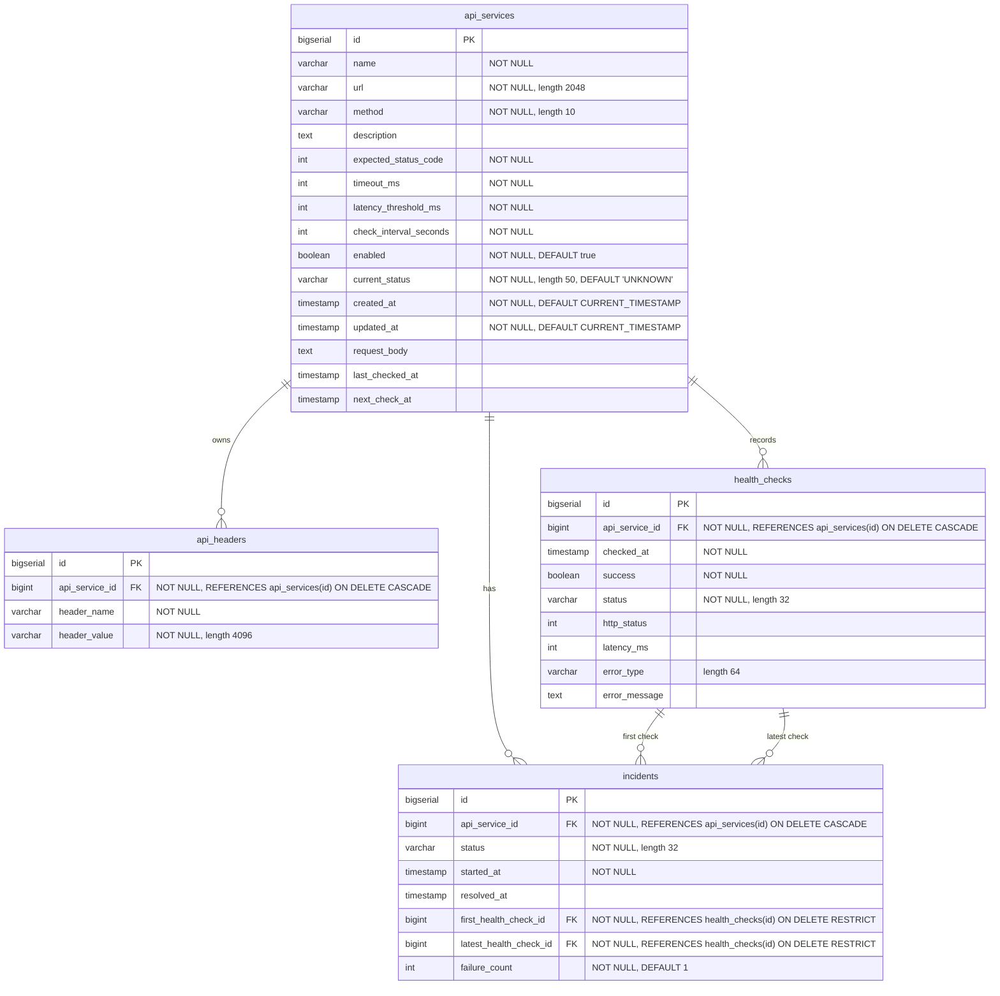
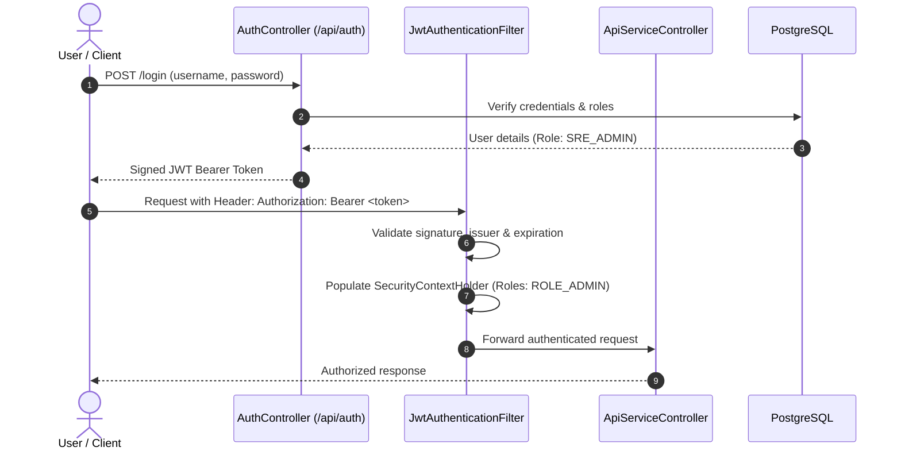
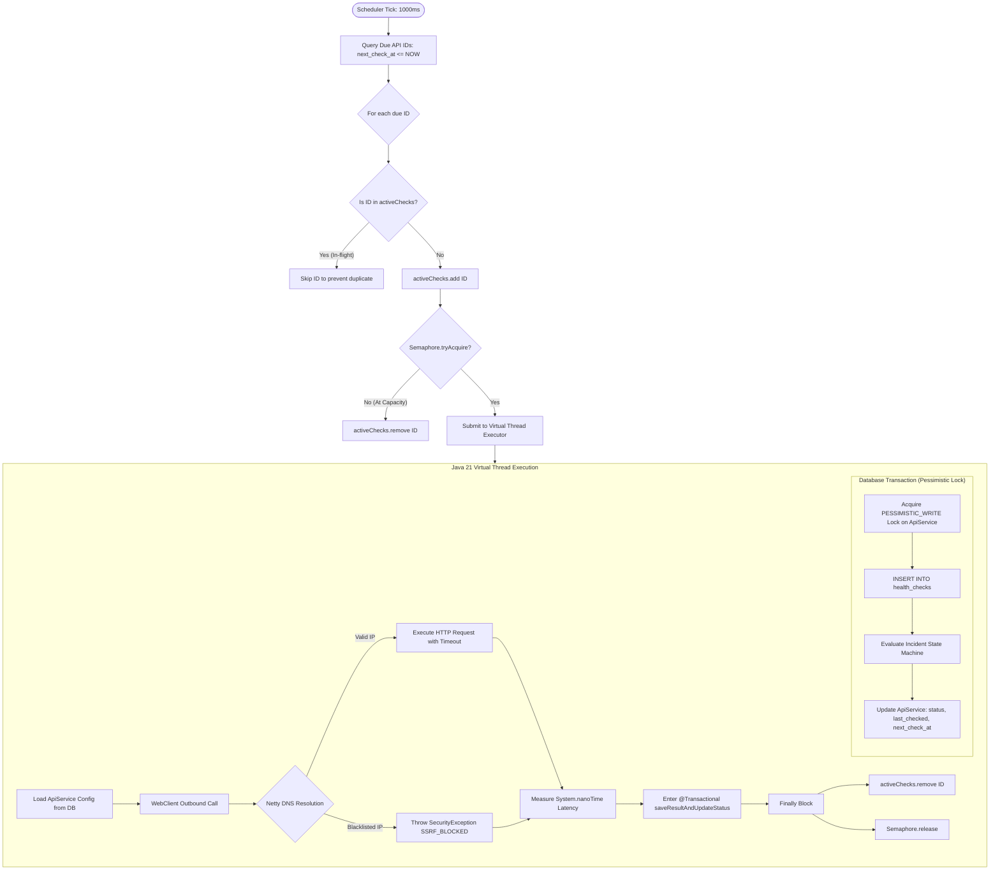
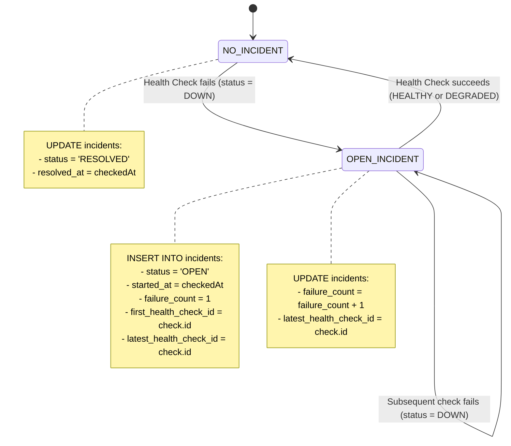
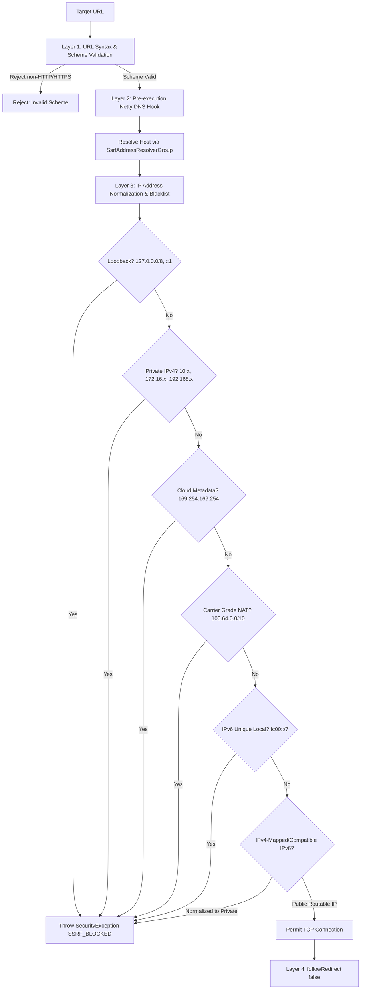

# Low-Level Design (LLD)
## RAIN — Third-Party API Reliability Observatory

**Document Reference:** RAIN-DOC-LLD-001  
**Project:** RAIN API Observatory  
**Target Audience:** Kalvium University Project Assessor, Evaluation Panel, Technical Viva Examiners  
**Implementation Language:** Java 21 (Backend), TypeScript / React 19 (Frontend), SQL (PostgreSQL 15)  
**Version:** 1.0.0  

---

## 1. Project Folder Structure

The complete repository structure for RAIN is organized logically into backend micro-domains, database migrations, and frontend modules:

```
RAIN-API-Observatory/
├── .env.example                                  # Environment variables template
├── .gitignore                                    # Git ignore configuration
├── docker-compose.yml                            # PostgreSQL 15 container definition
├── README.md                                     # Project overview and setup guide
├── ARCHITECTURE.md                               # Architectural patterns and rationale
├── LICENSE                                       # MIT open-source license
├── CONTRIBUTING.md                               # Contribution guidelines
├── docs/                                         # Engineering documentation
│   ├── PRD.md                                    # Product Requirements Document
│   ├── HLD.md                                    # High-Level Design Document
│   └── LLD.md                                    # Low-Level Design Document (this document)
├── backend/                                      # Spring Boot 3.4 / Java 21 Application
│   ├── mvnw / mvnw.cmd                           # Maven wrapper scripts
│   ├── pom.xml                                   # Maven dependencies and build definition
│   └── src/
│       ├── main/
│       │   ├── java/com/rain/
│       │   │   ├── RainApplication.java          # Spring Boot main entrypoint
│       │   │   ├── config/
│       │   │   │   └── WebClientConfig.java      # Netty WebClient & SSRF resolver configuration
│       │   │   ├── controller/
│       │   │   │   ├── ApiServiceController.java # API registry CRUD & control endpoints
│       │   │   │   ├── HealthController.java     # System health status endpoint (/api/health)
│       │   │   │   ├── IncidentController.java   # Incident audit & querying endpoints
│       │   │   │   └── MetricsController.java    # Telemetry and time-series endpoints
│       │   │   ├── dto/
│       │   │   │   ├── ApiHeaderRequest.java     # Header input DTO
│       │   │   │   ├── ApiHeaderResponse.java    # Sanitized header output DTO
│       │   │   │   ├── ApiMetricsResponse.java   # Single-service aggregated metrics DTO
│       │   │   │   ├── ApiServiceRequest.java    # Service registration/update DTO
│       │   │   │   ├── ApiServiceResponse.java   # Service full detail DTO
│       │   │   │   ├── DashboardSummaryResponse.java # Platform-wide aggregated metrics DTO
│       │   │   │   ├── HealthResponse.java       # System health probe response DTO
│       │   │   │   ├── IncidentDto.java          # Incident projection DTO
│       │   │   │   ├── LatencySeriesPoint.java   # Time-bucketed latency DTO
│       │   │   │   ├── SuccessFailureSeriesPoint.java # Time-bucketed volume DTO
│       │   │   │   └── TimeWindow.java           # Window enum (1h, 6h, 24h, 7d, 30d)
│       │   │   ├── entity/
│       │   │   │   ├── ApiHeader.java            # JPA Entity: HTTP custom headers
│       │   │   │   ├── ApiService.java           # JPA Entity: Monitored service metadata
│       │   │   │   ├── ApiStatus.java            # Enum: UNKNOWN, HEALTHY, DEGRADED, DOWN, PAUSED
│       │   │   │   ├── HealthCheck.java          # JPA Entity: Single check execution record
│       │   │   │   ├── HttpMethod.java           # Enum: GET, POST, PUT, PATCH, DELETE
│       │   │   │   ├── Incident.java             # JPA Entity: Failure event / incident record
│       │   │   │   └── IncidentStatus.java       # Enum: OPEN, RESOLVED
│       │   │   ├── exception/
│       │   │   │   ├── GlobalExceptionHandler.java # Centralized @RestControllerAdvice
│       │   │   │   └── ResourceNotFoundException.java # 404 Custom runtime exception
│       │   │   ├── intelligence/
│       │   │   │   ├── IntelligenceController.java # Intelligence REST endpoint
│       │   │   │   ├── IntelligenceService.java    # Score, anomaly detection & heuristic logic
│       │   │   │   └── dto/
│       │   │   │       ├── AnomalyDto.java       # Outlier check representation
│       │   │   │       ├── ErrorTypeDto.java     # Error category breakdown
│       │   │   │       └── ServiceIntelligenceResponse.java # Composite intelligence DTO
│       │   │   ├── monitoring/
│       │   │   │   ├── HealthCheckExecutor.java  # WebClient caller & latency measurement
│       │   │   │   ├── HealthCheckResult.java    # Java 21 Record holding check execution output
│       │   │   │   ├── MetricsService.java       # Telemetry orchestration service
│       │   │   │   ├── MonitoringEngineService.java # Health evaluation & incident state machine
│       │   │   │   ├── MonitoringScheduler.java  # Fixed-delay cron dispatcher with Virtual Threads
│       │   │   │   ├── SsrfAddressResolverGroup.java # Custom Netty AddressResolverGroup
│       │   │   │   └── SsrfValidator.java        # IP range & address validation component
│       │   │   ├── repository/
│       │   │   │   ├── ApiServiceRepository.java # JPA Repository with pessimistic locking
│       │   │   │   ├── HealthCheckRepository.java # JPA Repository for check history
│       │   │   │   ├── IncidentRepository.java   # JPA Repository for active/past incidents
│       │   │   │   └── MetricsRepository.java    # Native SQL analytics via JdbcTemplate
│       │   │   └── service/
│       │   │       ├── ApiRegistryService.java   # Business logic for API registration & lifecycle
│       │   │       └── IncidentService.java      # Read-only incident retrieval & DTO mapping
│       │   └── resources/
│       │       ├── application.yml               # Spring datasource and logging config
│       │       └── db/migration/                 # Flyway SQL migrations
│       │           ├── V1__init.sql
│       │           ├── V2__create_api_registry.sql
│       │           ├── V3__monitoring_engine_schema.sql
│       │           ├── V4__telemetry_metrics_index.sql
│       │           └── V5__incident_engine_schema.sql
│       └── test/                                 # Unit & Integration Test Suites
│           └── java/com/rain/
│               ├── ApiRegistryIntegrationTest.java
│               ├── controller/
│               ├── intelligence/
│               ├── monitoring/
│               └── service/
└── frontend/                                     # React 19 / TypeScript / Vite Application
    ├── package.json                              # Node dependencies and scripts
    ├── tsconfig.json                             # TypeScript compiler options
    ├── vite.config.ts                            # Vite configuration and backend API proxy
    ├── tailwind.config.js                        # Tailwind CSS design system rules
    └── src/
        ├── App.tsx                               # Root router and main layout shell
        ├── main.tsx                              # Application entrypoint & QueryClientProvider
        ├── index.css                             # Global CSS and Tailwind directives
        ├── components/
        │   ├── ApiMetrics.tsx                    # Service telemetry KPI cards
        │   ├── IncidentFeed.tsx                  # Historical and active incident audit list
        │   ├── IntelligencePanel.tsx             # Score, anomaly, MTTR and root-cause UI
        │   ├── LatencyChart.tsx                  # Recharts SVG line graph (Min, Max, Avg, P95)
        │   ├── ServiceObservatory.tsx            # Table displaying all registered monitors
        │   └── SuccessFailureChart.tsx           # Recharts area/bar distribution graph
        ├── pages/
        │   ├── AddApiPage.tsx                    # API registration form
        │   ├── ApiDetailsPage.tsx                # Deep-dive service dashboard
        │   ├── ApiRegistryPage.tsx               # Dedicated API management screen
        │   └── DashboardPage.tsx                 # System-wide observatory dashboard
        ├── services/
        │   ├── api.ts                            # Platform health query hook
        │   ├── apiRegistryHooks.ts               # React Query CRUD hooks for APIs
        │   ├── incidents.ts                      # React Query hooks for incidents
        │   ├── intelligenceHooks.ts              # React Query hooks for intelligence
        │   └── metrics.ts                        # React Query hooks for metrics & time series
        └── types/
            ├── incident.ts                       # Incident TypeScript interfaces
            ├── intelligence.ts                   # Intelligence TypeScript interfaces
            └── metrics.ts                        # Metrics and time-window interfaces
```

---

## 2. Backend & Frontend Module Descriptions

### 2.1 Backend Core Modules

#### 1. Configuration & Network (`com.rain.config`, `com.rain.monitoring`)
- **`WebClientConfig`**: Instantiates the Spring `WebClient` bean configured with a custom Netty `HttpClient`. Disables automatic redirect following (`followRedirect(false)`) and assigns the `SsrfAddressResolverGroup` to enforce IP safety.
- **`SsrfValidator`**: Core security utility that normalizes IPv4 and IPv6 addresses (including IPv4-mapped `::ffff:x.x.x.x` and IPv4-compatible formats) and evaluates them against blacklisted CIDR ranges (loopback, link-local, private, carrier-grade NAT, and cloud metadata `169.254.169.254`).
- **`SsrfAddressResolverGroup`**: Netty resolver decorator intercepting asynchronous DNS lookups. Validates every resolved `InetSocketAddress` before the TCP socket handshake proceeds, neutralizing DNS rebinding attacks.

#### 2. Service Registry (`com.rain.service`, `com.rain.controller`)
- **`ApiRegistryService`**: Contains transactional business logic for registering, modifying, pausing, resuming, and deleting APIs. Validates URI syntax, redacts sensitive headers in output DTOs, and joins open incidents to supply the `hasActiveIncident` flag.
- **`ApiServiceController`**: Exposes REST endpoints on `/api/services` handling validation via `@Valid`.

#### 3. Monitoring Engine (`com.rain.monitoring`)
- **`MonitoringScheduler`**: Fixed-delay background job executing every 1,000ms. Queries due API IDs from the repository, skips IDs currently present in `activeChecks`, acquires permits from a `Semaphore(100)`, and delegates execution to Java 21 Virtual Threads.
- **`HealthCheckExecutor`**: Performs outbound HTTP requests using non-blocking reactive `WebClient`. Sets request timeout via `.timeout(Duration.ofMillis(...))` and measures execution latency in milliseconds using `System.nanoTime()`. Catches security exceptions as `SSRF_BLOCKED` and network failures as `TIMEOUT`, `CONNECTION_REFUSED`, or `DNS_ERROR`.
- **`MonitoringEngineService`**: Orchestrates health checks and saves results. Separates external HTTP calls (executed outside any database transaction) from status persistence. Persists state using an internal self-proxy (`self.saveResultAndUpdateStatus`) marked `@Transactional`. Acquires a pessimistic write lock on the target API row, saves the `HealthCheck`, updates or resolves open incidents, and advances `next_check_at`.

#### 4. Telemetry & Analytics (`com.rain.monitoring`, `com.rain.repository`)
- **`MetricsRepository`**: Utilizes Spring `JdbcTemplate` to execute SQL queries on the `health_checks` table using PostgreSQL native functions (`PERCENTILE_CONT(0.95)`, `COUNT(*) FILTER (...)`, and `date_trunc(...)`).
- **`MetricsService`**: Provides data aggregation across selectable time windows (`1h`, `6h`, `24h`, `7d`, `30d`), combining check telemetry with real-time registry counts (`healthy`, `degraded`, `down`, `paused`).

#### 5. Intelligence Engine (`com.rain.intelligence`)
- **`IntelligenceService`**: Implements statistical analysis algorithms on recent health checks:
  - *Reliability Score:* Computes weighted score: $100 \times (0.70 \times \text{Availability} + 0.30 \times \text{Latency Compliance})$.
  - *Score Trend:* Categorizes change as `IMPROVING`, `DECLINING`, or `STABLE`.
  - *Anomaly Detection:* Evaluates whether latency exceeds $\mu + 3\sigma$ based on a rolling baseline of preceding checks.
  - *Error Categorization:* Aggregates failure counts and percentages.
  - *MTTR:* Calculates average duration of resolved incidents in the selected window.
  - *Diagnostic Hints:* Identifies recurring error patterns ($\ge 80\%$) and preceding latency degradations.

### 2.2 Frontend Core Modules

- **`DashboardPage`**: Central landing screen rendering global metric tiles, active incident alerts, and the full interactive service observatory table.
- **`ApiDetailsPage`**: Detailed single-service dashboard providing time-window switching, latency line charts, success/failure charts, incident logs, and the intelligence diagnostics panel.
- **`LatencyChart`**: Interactive Recharts SVG visualization plotting Average, P95, Min, and Max latency series across UTC timestamps.
- **`SuccessFailureChart`**: Recharts visual breakdown displaying successful versus failed check volumes per time bucket.
- **`IntelligencePanel`**: Displays reliability score badge, trend indicator, anomaly log, error breakdown table, MTTR, and automated root cause hints.
- **`apiRegistryHooks` & `metrics`**: TanStack React Query custom hooks managing data fetching, optimistic cache invalidation, and automated 30-second background polling.

---

## 3. Database Tables & Relationships



### Table Definitions & Column Specifications

#### 1. `api_services` Table
| Column Name | SQL Type | Nullable | Default | Description |
|---|---|---|---|---|
| `id` | `BIGSERIAL` | NO | Auto | Primary Key |
| `name` | `VARCHAR(255)` | NO | None | Human-readable name |
| `url` | `VARCHAR(2048)` | NO | None | Target HTTP/HTTPS endpoint |
| `method` | `VARCHAR(10)` | NO | None | HTTP verb (`GET`, `POST`, etc.) |
| `description` | `TEXT` | YES | NULL | Optional documentation |
| `expected_status_code`| `INTEGER` | NO | None | Expected HTTP response code (e.g. 200) |
| `timeout_ms` | `INTEGER` | NO | None | Max execution time in ms |
| `latency_threshold_ms`| `INTEGER` | NO | None | Threshold for `DEGRADED` status |
| `check_interval_seconds`| `INTEGER` | NO | None | Polling frequency in seconds |
| `enabled` | `BOOLEAN` | NO | `TRUE` | Whether active monitoring is enabled |
| `current_status` | `VARCHAR(50)` | NO | `'UNKNOWN'` | Current status (`HEALTHY`, `DOWN`, etc.) |
| `created_at` | `TIMESTAMPTZ` | NO | `CURRENT_TIMESTAMP` | Entity creation timestamp |
| `updated_at` | `TIMESTAMPTZ` | NO | `CURRENT_TIMESTAMP` | Last update timestamp |
| `request_body` | `TEXT` | YES | NULL | Request payload for POST/PUT |
| `last_checked_at` | `TIMESTAMPTZ` | YES | NULL | Timestamp of last check execution |
| `next_check_at` | `TIMESTAMPTZ` | YES | NULL | Timestamp when next check is due |

#### 2. `api_headers` Table
| Column Name | SQL Type | Nullable | Description |
|---|---|---|---|
| `id` | `BIGSERIAL` | NO | Primary Key |
| `api_service_id` | `BIGINT` | NO | FK to `api_services(id)` ON DELETE CASCADE |
| `header_name` | `VARCHAR(255)` | NO | HTTP Header key |
| `header_value` | `VARCHAR(4096)`| NO | HTTP Header secret/value |

#### 3. `health_checks` Table
| Column Name | SQL Type | Nullable | Description |
|---|---|---|---|
| `id` | `BIGSERIAL` | NO | Primary Key |
| `api_service_id` | `BIGINT` | NO | FK to `api_services(id)` ON DELETE CASCADE |
| `checked_at` | `TIMESTAMPTZ` | NO | Check observation timestamp |
| `success` | `BOOLEAN` | NO | True if healthy or degraded; false if down |
| `status` | `VARCHAR(32)` | NO | `HEALTHY`, `DEGRADED`, or `DOWN` |
| `http_status` | `INTEGER` | YES | Returned HTTP code (null if connection failed) |
| `latency_ms` | `INTEGER` | YES | Elapsed roundtrip duration (null on timeout) |
| `error_type` | `VARCHAR(64)` | YES | E.g. `TIMEOUT`, `DNS_ERROR`, `HTTP_STATUS_MISMATCH` |
| `error_message` | `TEXT` | YES | Detailed exception or status mismatch string |

*Indexes:*
- `idx_health_checks_api_id`: `(api_service_id, checked_at DESC)`
- `idx_health_checks_checked_at`: `(checked_at)`

#### 4. `incidents` Table
| Column Name | SQL Type | Nullable | Default | Description |
|---|---|---|---|---|
| `id` | `BIGSERIAL` | NO | Auto | Primary Key |
| `api_service_id` | `BIGINT` | NO | None | FK to `api_services(id)` ON DELETE CASCADE |
| `status` | `VARCHAR(32)` | NO | None | `OPEN` or `RESOLVED` |
| `started_at` | `TIMESTAMPTZ` | NO | None | Start timestamp from triggering check |
| `resolved_at` | `TIMESTAMPTZ` | YES | NULL | Resolution timestamp from recovery check |
| `first_health_check_id` | `BIGINT`| NO | None | FK to `health_checks(id)` ON DELETE RESTRICT |
| `latest_health_check_id`| `BIGINT`| NO | None | FK to `health_checks(id)` ON DELETE RESTRICT |
| `failure_count` | `INTEGER` | NO | 1 | Number of consecutive failed checks |

*Indexes & Constraints:*
- `idx_incidents_api_id_status`: `(api_service_id, status)`
- `idx_incidents_started_at`: `(started_at DESC)`
- `uq_incidents_one_open_per_api`: Partial Unique Index `UNIQUE (api_service_id) WHERE status = 'OPEN'`

---

## 4. API Endpoints & Contract Specifications

### 4.1 System Health
- **`GET /api/health`**
  - **Response (200 OK):**
    ```json
    {
      "status": "UP",
      "service": "RAIN API",
      "timestamp": "2026-11-19T06:21:44.123456Z"
    }
    ```

### 4.2 Service Registry Endpoints (`/api/services`)

| Method | Endpoint | Description | Status Codes |
|---|---|---|---|
| `GET` | `/api/services` | List all registered services | 200 |
| `GET` | `/api/services/{id}` | Get single service details | 200, 404 |
| `POST` | `/api/services` | Register a new API | 201, 400 |
| `PUT` | `/api/services/{id}` | Update existing API configuration | 200, 400, 404 |
| `DELETE` | `/api/services/{id}` | Delete API and associated data | 204, 404 |
| `POST` | `/api/services/{id}/pause` | Pause scheduled monitoring | 200, 404 |
| `POST` | `/api/services/{id}/resume` | Resume scheduled monitoring | 200, 404 |
| `POST` | `/api/services/{id}/check` | Trigger on-demand immediate check | 200, 400, 404 |

#### Example: `POST /api/services` (Request Body)
```json
{
  "name": "Stripe Payments API",
  "url": "https://api.stripe.com/healthcheck",
  "method": "GET",
  "description": "Core payment processing gateway endpoint",
  "expectedStatusCode": 200,
  "timeoutMs": 3000,
  "latencyThresholdMs": 800,
  "checkIntervalSeconds": 30,
  "requestBody": null,
  "headers": [
    {
      "headerName": "Authorization",
      "headerValue": "Bearer sk_test_secret_key"
    }
  ]
}
```

#### Example: `GET /api/services/{id}` (Sanitized Response Body)
```json
{
  "id": 1,
  "name": "Stripe Payments API",
  "url": "https://api.stripe.com/healthcheck",
  "method": "GET",
  "description": "Core payment processing gateway endpoint",
  "expectedStatusCode": 200,
  "timeoutMs": 3000,
  "latencyThresholdMs": 800,
  "checkIntervalSeconds": 30,
  "enabled": true,
  "currentStatus": "HEALTHY",
  "createdAt": "2026-11-19T06:00:00Z",
  "updatedAt": "2026-11-19T06:00:00Z",
  "requestBody": null,
  "lastCheckedAt": "2026-11-19T06:21:30Z",
  "nextCheckAt": "2026-11-19T06:22:00Z",
  "headers": [
    {
      "headerName": "Authorization",
      "configured": true
    }
  ],
  "hasActiveIncident": false
}
```

### 4.3 Telemetry & Metrics Endpoints (`/api`)

#### 1. `GET /api/dashboard/summary?window={1h|6h|24h|7d|30d}`
- **Response (200 OK):**
  ```json
  {
    "window": "24h",
    "totalApis": 8,
    "enabledApis": 7,
    "pausedApis": 1,
    "healthyApis": 6,
    "degradedApis": 1,
    "downApis": 0,
    "unknownApis": 0,
    "totalChecks": 14250,
    "successfulChecks": 14210,
    "failedChecks": 40,
    "overallCheckBasedUptimePercentage": 99.719,
    "overallAverageResponseLatencyMs": 142.45,
    "overallP95ResponseLatencyMs": 320.0,
    "activeIncidents": 0
  }
  ```

#### 2. `GET /api/services/{id}/metrics?window={1h|6h|24h|7d|30d}`
- **Response (200 OK):**
  ```json
  {
    "window": "24h",
    "totalChecks": 2880,
    "successfulChecks": 2875,
    "failedChecks": 5,
    "uptimePercentage": 99.826,
    "failureRate": 0.174,
    "averageResponseLatencyMs": 128.5,
    "p95ResponseLatencyMs": 285.0,
    "currentStatus": "HEALTHY",
    "lastCheckedAt": "2026-11-19T06:21:30Z",
    "lastSuccessfulAt": "2026-11-19T06:21:30Z",
    "lastFailedAt": "2026-11-19T04:12:00Z"
  }
  ```

#### 3. `GET /api/services/{id}/metrics/latency?window={1h|6h|24h|7d|30d}`
- **Response (200 OK):**
  ```json
  [
    {
      "timestamp": "2026-11-19T05:00:00Z",
      "averageResponseLatencyMs": 124.2,
      "p95ResponseLatencyMs": 240.0,
      "minResponseLatencyMs": 85.0,
      "maxResponseLatencyMs": 412.0
    }
  ]
  ```

#### 4. `GET /api/services/{id}/metrics/success-failure?window={1h|6h|24h|7d|30d}`
- **Response (200 OK):**
  ```json
  [
    {
      "timestamp": "2026-11-19T05:00:00Z",
      "successful": 119,
      "failed": 1
    }
  ]
  ```

### 4.4 Incident Audit Endpoints (`/api`)

#### 1. `GET /api/incidents?limit=50`
#### 2. `GET /api/services/{id}/incidents?limit=50`
- **Response (200 OK):**
  ```json
  [
    {
      "id": 14,
      "apiServiceId": 1,
      "status": "RESOLVED",
      "startedAt": "2026-11-19T04:10:00Z",
      "resolvedAt": "2026-11-19T04:14:30Z",
      "failureCount": 9,
      "latestErrorType": "HTTP_STATUS_MISMATCH",
      "latestErrorMessage": "Expected 200 but got 503",
      "latestHttpStatus": 503,
      "latestLatencyMs": 185
    }
  ]
  ```

### 4.5 Intelligence Endpoint (`/api/services/{id}/intelligence`)
- **`GET /api/services/{id}/intelligence?window={1h|6h|24h|7d|30d}`**
- **Response (200 OK):**
  ```json
  {
    "reliabilityScore": 98.42,
    "scoreTrend": "STABLE",
    "totalAnomalies": 1,
    "anomalies": [
      {
        "healthCheckId": 8921,
        "checkedAt": "2026-11-19T05:14:00Z",
        "latencyMs": 1450,
        "baselineAvgMs": 125.4,
        "baselineStdDevMs": 42.1
      }
    ],
    "topErrorTypes": [
      {
        "errorType": "HTTP_STATUS_MISMATCH",
        "count": 4,
        "percentage": 80.0
      },
      {
        "errorType": "TIMEOUT",
        "count": 1,
        "percentage": 20.0
      }
    ],
    "avgRecoveryTimeMs": 270000,
    "rootCauseHints": [
      "Evidence indicates repeated HTTP_STATUS_MISMATCH failures (80.0% of failures)."
    ]
  }
  ```

---

## 5. Authentication & Authorization Flow

### 5.1 Current Implementation Status: Developer Mode
In accordance with the current development phase (Phase 1–7):
- **Access Control:** No authentication layer is enforced. The REST API endpoints are open and accessible directly or through the Vite development proxy.
- **Cross-Origin Resource Sharing (CORS):** Controllers use `@CrossOrigin(origins = "*")` allowing development frontends to interface directly with port `8080`.
- **Sensitive Data Scrubbing:** Even without user authentication, outgoing API responses systematically redact sensitive header values, exposing only `{"headerName": "...", "configured": true}`.

### 5.2 Planned Architecture: Spring Security & JWT (Phase 8 Roadmap)



Planned Role Matrix:
- `ROLE_ADMIN`: Full access to create, update, delete, pause/resume, and configure API endpoints.
- `ROLE_OPERATOR`: Can trigger manual checks, pause/resume services, and view all dashboards.
- `ROLE_VIEWER`: Read-only access to dashboard metrics, latency charts, and incident feeds.

---

## 6. Monitoring & Worker Execution Flow



### Architectural Safeguards in Monitoring
1. **Zero Thread Starvation:** Traditional thread pools with fixed workers (e.g. 50 OS threads) block when external APIs take 5 seconds to time out. RAIN uses Java 21 Virtual Threads, where thousands of virtual threads can block concurrently on socket I/O without consuming OS thread stacks.
2. **Double In-Flight Prevention:** If a service with an interval of 5s experiences an 8s timeout, the scheduler tick at second 6 would normally re-trigger it. RAIN's `activeChecks` concurrent hash set prevents overlapping checks for the same API.
3. **Short Transaction Window:** Database connections and row locks are **not** held while waiting for external network responses. Network execution occurs completely un-transactioned; once the result is in memory, a sub-millisecond database transaction is opened to persist the result.

---

## 7. Health Classification & Incident Lifecycle

### 7.1 Status Evaluation Logic

The status of a health check is computed using the following truth table:

| Network Result | HTTP Status Code | Response Latency | Resulting `ApiStatus` | `success` Flag |
|---|---|---|---|---|
| Response Received | Equals `expectedStatusCode` | $\le latencyThresholdMs$ | `HEALTHY` | `true` |
| Response Received | Equals `expectedStatusCode` | $> latencyThresholdMs$ | `DEGRADED` | `true` |
| Response Received | Does NOT Equal `expectedStatusCode` | Any | `DOWN` (`HTTP_STATUS_MISMATCH`) | `false` |
| Timeout Exception | None | Exceeds `timeoutMs` | `DOWN` (`TIMEOUT`) | `false` |
| Connection Refused | None | Any | `DOWN` (`CONNECTION_REFUSED`) | `false` |
| DNS Unknown Host | None | Any | `DOWN` (`DNS_ERROR`) | `false` |
| SSRF Security Exception| None | Immediate | `DOWN` (`SSRF_BLOCKED`) | `false` |

### 7.2 Incident State Transitions



### 7.3 Concurrency & Deduplication Guarantees
- **Application Level:** When `saveResultAndUpdateStatus` executes, it invokes `apiServiceRepository.findWithLockById(apiServiceId)` which issues a SQL query with `FOR UPDATE`. This forces any parallel execution for the same service to wait until the first transaction commits.
- **Database Level:** The partial unique index:
  ```sql
  CREATE UNIQUE INDEX uq_incidents_one_open_per_api
  ON incidents(api_service_id)
  WHERE status = 'OPEN';
  ```
  ensures that even if two threads were to bypass application locks, the database would reject duplicate active incident inserts with a unique key violation.

---

## 8. Analytics Calculations & Formulas

### 8.1 Telemetry Formulas & SQL Queries

#### 1. Check-Based Uptime Percentage
$$\text{Uptime \%} = \frac{\sum \text{Checks where } success = true}{\text{Total Checks in Window}} \times 100$$
*SQL Implementation (`MetricsRepository.java`):*
```sql
CASE WHEN COUNT(*) > 0 THEN 
    (COUNT(*) FILTER (WHERE success = true) * 100.0) / COUNT(*) 
ELSE NULL END AS uptime_percentage
```

#### 2. Failure Rate
$$\text{Failure Rate \%} = \frac{\sum \text{Checks where } success = false}{\text{Total Checks in Window}} \times 100$$
*SQL Implementation:*
```sql
CASE WHEN COUNT(*) > 0 THEN 
    (COUNT(*) FILTER (WHERE success = false) * 100.0) / COUNT(*) 
ELSE NULL END AS failure_rate
```

#### 3. 95th Percentile (P95) Latency
Computes the continuous percentile of observed response latencies, filtering out timeouts (`latency_ms IS NULL`):
*SQL Implementation:*
```sql
PERCENTILE_CONT(0.95) WITHIN GROUP (ORDER BY latency_ms) AS p95_response_latency_ms
```

#### 4. Time-Bucket Aggregation
Using PostgreSQL `date_trunc`:
```sql
SELECT 
    date_trunc(:postgresInterval, checked_at AT TIME ZONE 'UTC') AS bucket_timestamp,
    AVG(latency_ms) AS average_response_latency_ms,
    PERCENTILE_CONT(0.95) WITHIN GROUP (ORDER BY latency_ms) AS p95_response_latency_ms,
    MIN(latency_ms) AS min_response_latency_ms,
    MAX(latency_ms) AS max_response_latency_ms
FROM health_checks 
WHERE api_service_id = :id AND checked_at >= :cutoff AND latency_ms IS NOT NULL
GROUP BY bucket_timestamp
ORDER BY bucket_timestamp ASC;
```

### 8.2 Intelligence Engine Formulas

#### 1. Composite Reliability Score
$$\text{Score} = 100.0 \times \left(0.70 \times \frac{N_{\text{success}}}{N_{\text{total}}} + 0.30 \times \frac{N_{\text{latency} \le \text{threshold}}}{N_{\text{valid\_latency}}}\right)$$
Where:
- $N_{\text{success}}$ is the count of checks where `success = true`.
- $N_{\text{total}}$ is the total number of checks in the window.
- $N_{\text{latency} \le \text{threshold}}$ is the count of successful checks with latency within the threshold.
- $N_{\text{valid\_latency}}$ is the count of successful checks with non-null latency.

#### 2. Statistical Anomaly Detection ($\mu + 3\sigma$)
For each check $i$, a rolling baseline of the preceding 50 successful checks is extracted:
$$\mu = \frac{1}{N} \sum_{k=1}^{N} \text{latency}_k$$
$$\sigma = \sqrt{\frac{1}{N} \sum_{k=1}^{N} (\text{latency}_k - \mu)^2}$$
$$\text{Anomaly Threshold} = \begin{cases} \mu + 3\sigma & \text{if } \sigma > 0 \\ 1.5\mu & \text{if } \sigma = 0 \end{cases}$$
If $\text{latency}_i > \text{Threshold}$, the check is recorded as an anomaly.

#### 3. Mean Time to Recovery (MTTR)
$$\text{MTTR} = \frac{1}{|I_{\text{resolved}}|} \sum_{i \in I_{\text{resolved}}} (\text{resolved\_at}_i - \text{started\_at}_i)$$

---

## 9. Security Implementation Details

### 9.1 Multi-Layer SSRF Defense Architecture



### 9.2 Blocked IP Ranges & Specifications

| Category | CIDR / Address Range | Purpose of Block |
|---|---|---|
| **Loopback** | `127.0.0.0/8`, `::1` | Prevents probing local host services on port 8080/5432. |
| **Link-Local / Metadata** | `169.254.0.0/16`, `fe80::/10` | Blocks access to AWS/GCP/Azure instance metadata credentials (`169.254.169.254`). |
| **Private Class A** | `10.0.0.0/8` | Protects corporate and container internal networks. |
| **Private Class B** | `172.16.0.0/12` | Protects Docker default bridge networks (`172.17.x.x`). |
| **Private Class C** | `192.168.0.0/16` | Protects local subnet hardware, routers, and internal servers. |
| **AnyLocal / Zero** | `0.0.0.0/32`, `::` | Blocks wildcard binding exploitation. |
| **Carrier-Grade NAT** | `100.64.0.0/10` | Blocks shared ISP and container carrier NAT address spaces. |
| **IPv6 Unique Local** | `fc00::/7` | Blocks private IPv6 intra-network traffic. |
| **IPv4-Mapped IPv6** | `::ffff:127.0.0.1` | Normalizes obfuscated IPv6 representations to IPv4 before validation. |

### 9.3 Redirect Disablement
Attackers frequently bypass initial URL validation by providing a public URL that returns an HTTP `301` or `302` redirect pointing to `http://169.254.169.254/latest/meta-data/`. RAIN explicitly neutralizes this vector in `WebClientConfig`:
```java
HttpClient httpClient = HttpClient.create()
    .followRedirect(false)
    .resolver(new SsrfAddressResolverGroup(ssrfValidator));
```
Any attempt to issue an HTTP redirect causes the client to return the redirect status directly without following it.
