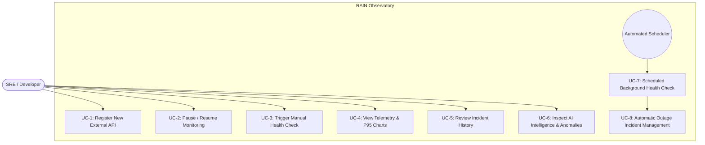

# Product Requirements Document (PRD)
## RAIN — Third-Party API Reliability Observatory

**Document Reference:** RAIN-DOC-PRD-001  
**Project:** RAIN API Observatory  
**Target Audience:** Kalvium University Project Assessor, Evaluation Panel, Technical Viva Board  
**Status:** Implemented (Core & Intelligence Engine Completed)  
**Version:** 1.0.0  

---

## 1. Project Overview & Problem Statement

### 1.1 Project Overview
**RAIN (Reliability and Availability Intelligence Network)** is an automated third-party API reliability monitoring and observatory platform. It allows software development, operations, and site reliability engineering (SRE) teams to register external dependency APIs, orchestrate scheduled non-blocking health checks, evaluate performance metrics, automatically detect outages through an incident management engine, and surface statistical latency anomalies alongside heuristic root-cause hints.

### 1.2 Problem Statement
Modern microservices and distributed software architectures depend heavily on external software-as-a-service (SaaS) and third-party APIs (e.g., payment gateways like Stripe/Razorpay, authentication providers like Auth0, SMS gateways like Twilio, mapping services, and cloud endpoints). 

In practice:
1. **Silent External Degradations:** Third-party APIs frequently experience silent degradation—elevated response latencies, unexpected error statuses (5xx, 4xx), intermittent dropped connections, or complete outages—before any official public status page is updated.
2. **Reactive Troubleshooting:** Internal engineering teams often discover downstream dependency failures only after their end-users complain, leading to high Mean Time to Detect (MTTD) and severe customer friction.
3. **Lack of Granular Performance Observability:** Generic ping tools only measure simple up/down status without analyzing latency compliance against contractual Service Level Objectives (SLOs) or detecting statistical performance outliers (spikes).
4. **Security Vulnerabilities in Dynamic Monitors:** Naive HTTP monitoring platforms that permit arbitrary user-provided URLs risk Server-Side Request Forgery (SSRF), exposing internal cloud metadata services (e.g., AWS `169.254.169.254`), private infrastructure, and container network interfaces.

RAIN bridges this gap by functioning as a dedicated, active monitoring observatory with enterprise-grade SSRF defense, pessimistic concurrency control for zero-duplicate incidents, and automated statistical telemetry.

---

## 2. Objectives and Scope

### 2.1 Project Objectives
- **Proactive Failure Detection:** Detect third-party API downtime and latency regressions before end-users encounter failures.
- **Automated Incident Lifecycle:** Transition incidents automatically from `OPEN` to `RESOLVED` based on real observation events without human intervention.
- **Actionable Statistical Intelligence:** Move beyond binary uptime by evaluating 95th percentile (P95) latency, standard deviation ($\sigma$) anomaly detection, and automated root-cause heuristics.
- **Safe Outbound Execution:** Enforce strict network-layer and address-resolution level protections preventing SSRF attacks against internal network resources.
- **Single Source of Truth:** Eliminate hardcoded mock data in the frontend; all statistics and visual charts are computed dynamically from real PostgreSQL records.

### 2.2 Project Scope

#### In Scope (Implemented)
- **API Registry & Metadata Management:** Full CRUD operations on HTTP endpoints, custom request headers, configurable timeouts, custom expected HTTP status codes, latency thresholds, and check intervals.
- **Lifecycle Management:** Pausing and resuming individual service monitors; manual on-demand health check triggering.
- **Scheduled Monitoring Engine:** Automated cron-like dispatcher running every 1000ms using Java 21 Virtual Threads and semaphores for concurrent execution.
- **SSRF Defense Architecture:** Multi-layer validation blocking loopback, link-local, private IPv4/IPv6, carrier-grade NAT, and cloud metadata addresses at the Netty DNS resolution layer.
- **Check-Based Telemetry:** Continuous aggregation of total checks, success/failure counts, check-based uptime percentage, average response latency, and P95 latency across multiple time windows (1h, 6h, 24h, 7d, 30d).
- **Incident Engine:** Outage detection guaranteeing at most one active `OPEN` incident per API service using database partial unique constraints and JPA pessimistic write locking (`PESSIMISTIC_WRITE`).
- **Intelligence Engine:** Algorithmic reliability scoring ($100 \times [0.70 \times \text{Availability} + 0.30 \times \text{Latency Compliance}]$), score trend evaluation (`IMPROVING`, `STABLE`, `DECLINING`), statistical anomaly detection ($\mu + 3\sigma$), MTTR calculation, and rule-based root cause hints.
- **Observatory User Interface:** Modern responsive React SPA featuring a platform dashboard, registry management, deep-dive telemetry charts (Recharts), incident audit feed, and intelligence breakdown cards.

#### Out of Scope (Planned for Future Enhancements)
- Multi-tenant authentication, user authorization (RBAC), and API key management.
- External alerting integrations (Webhooks, Slack, PagerDuty, Email notifications).
- Distributed multi-region probe workers (distributed agent probes across geographic zones).
- Historical database table partitioning and automated data archival/rollups.
- Synthetic multi-step transaction monitoring (e.g., OAuth authentication followed by tokenized API call chains).

---

## 3. Target Users

| User Persona | Responsibilities & Goals | How RAIN Delivers Value |
|---|---|---|
| **Site Reliability Engineer (SRE)** | Maintain system availability, meet Service Level Agreements (SLAs), and troubleshoot outage alerts. | Receives automatic incident detection, MTTR tracking, and latency regression trends across external dependencies. |
| **Backend / Platform Engineer** | Integrate external APIs (payment gateways, notification brokers, identity systems). | Configures expected status codes, evaluates P95 latency compliance, and pinpoints whether service failures are external or internal. |
| **Engineering Manager / Assessor** | Verify platform reliability standards, evaluate architectural robustness, and audit dependency health. | Reviews high-level platform health summaries, reliability scores, and audit trails of historical failure events. |

---

## 4. Functional Requirements

### 4.1 Module 1: API Registry & Service Management (FR-1)
- **FR-1.1 Service Registration:** The system shall allow users to register an external API with:
  - `name`: Human-readable identifier.
  - `url`: Target endpoint (must use `http://` or `https://`).
  - `method`: HTTP verb (`GET`, `POST`, `PUT`, `PATCH`, `DELETE`).
  - `description`: Optional documentation text.
  - `expectedStatusCode`: Integer (100–599) denoting a successful response.
  - `timeoutMs`: Request timeout limit in milliseconds (> 0).
  - `latencyThresholdMs`: Acceptable latency before marking service as degraded ($\ge 0$).
  - `checkIntervalSeconds`: Polling frequency in seconds ($\ge 1$).
  - `requestBody`: Optional payload string for POST/PUT/PATCH requests.
  - `headers`: List of key-value HTTP headers sent with each check.
- **FR-1.2 Service Modification & Deletion:** The system shall allow updating existing configuration parameters (automatically recalculating the next check time upon interval changes) and cascade-deleting services and associated headers.
- **FR-1.3 Service Lifecycle Controls:** The system shall allow pausing an active service (setting status to `PAUSED` and halting automated checks) and resuming a paused service (resetting status to `UNKNOWN` and scheduling immediate execution).
- **FR-1.4 Header Security Masking:** When querying service details, the backend shall expose header names with an indicator flag (`configured: true`) while redacting raw secret header values to prevent credential leakage.

### 4.2 Module 2: Automated Monitoring Engine (FR-2)
- **FR-2.1 Periodic Due Check Dispatching:** The scheduler shall execute every 1,000 milliseconds, querying all enabled services where `next_check_at <= NOW()` or `next_check_at IS NULL`.
- **FR-2.2 Concurrency & Worker Scaling:** The scheduler shall dispatch due checks asynchronously using Java 21 Virtual Threads (`Executors.newVirtualThreadPerTaskExecutor()`), capped by a configurable semaphore permit pool (default 100 permits).
- **FR-2.3 In-Flight Execution Deduplication:** The scheduler shall utilize an in-memory concurrent set (`activeChecks`) to guarantee that an API currently executing a check is never dispatched again in parallel.
- **FR-2.4 Non-Blocking Network Execution:** External HTTP requests shall be executed using non-blocking reactive WebClient calls configured with exact request timeouts.
- **FR-2.5 Manual On-Demand Execution:** The system shall provide an endpoint allowing users to trigger an immediate, isolated health check for any active API service.
- **FR-2.6 Server-Side Request Forgery (SSRF) Prevention:** The network client shall reject connections to private, loopback, link-local, carrier-grade NAT, or cloud metadata IP addresses at the DNS resolution stage and disable automatic HTTP redirects.

### 4.3 Module 3: Health Classification & Incident Management (FR-3)
- **FR-3.1 Status Classification Logic:**
  - `HEALTHY`: Check succeeds, HTTP status matches `expectedStatusCode`, and response latency $\le latencyThresholdMs$.
  - `DEGRADED`: Check succeeds, HTTP status matches `expectedStatusCode`, but response latency $> latencyThresholdMs$.
  - `DOWN`: Check fails due to HTTP status mismatch, network timeout, connection refused, DNS error, or SSRF block.
  - `PAUSED`: User paused monitoring.
  - `UNKNOWN`: Initial state prior to the first completed check.
- **FR-3.2 Incident Creation:** If a health check evaluates to `DOWN` and no `OPEN` incident currently exists for that service, the system shall instantiate a new `Incident` with status `OPEN`, recording `startedAt`, linking the triggering health check, and initializing `failureCount = 1`.
- **FR-3.3 Incident Failure Counter:** If a subsequent health check fails while an incident is already `OPEN`, the system shall increment `failureCount` and update `latestHealthCheckId`.
- **FR-3.4 Incident Automatic Resolution:** If a service with an `OPEN` incident produces a successful check (`HEALTHY` or `DEGRADED`), the system shall immediately update the incident status to `RESOLVED` and record `resolvedAt` timestamp.
- **FR-3.5 Concurrency Invariant:** The database and application layer shall strictly enforce that no API service may possess more than one `OPEN` incident concurrently.

### 4.4 Module 4: Telemetry & Metrics Engine (FR-4)
- **FR-4.1 Check-Based Uptime:** The system shall calculate uptime as:
  $$\text{Uptime \%} = \frac{\text{Successful Checks}}{\text{Total Checks}} \times 100$$
- **FR-4.2 Percentile Latency (P95):** The system shall compute the 95th percentile latency using PostgreSQL's continuous percentile aggregation function `PERCENTILE_CONT(0.95)`, excluding timeout failures (`latency_ms IS NULL`).
- **FR-4.3 Time Window Support:** All telemetry endpoints shall support selectable analysis windows: `1h`, `6h`, `24h`, `7d`, and `30d`.
- **FR-4.4 Time-Series Bucketing:**
  - Windows `1h` and `6h`: 1-minute aggregation buckets via `date_trunc('minute', ...)`.
  - Windows `24h` and `7d`: 1-hour aggregation buckets via `date_trunc('hour', ...)`.
  - Window `30d`: 1-day aggregation buckets via `date_trunc('day', ...)`.
- **FR-4.5 Platform Overview Aggregations:** Global telemetry shall report total checks, successful checks, failed checks, global uptime %, global average latency, global P95 latency, total APIs, enabled APIs, paused APIs, breakdown by current status, and total active incidents.

### 4.5 Module 5: Intelligence & Anomaly Engine (FR-5)
- **FR-5.1 Composite Reliability Score:** The system shall compute a normalized score ($0.0 - 100.0$) using the formula:
  $$\text{Reliability Score} = 100.0 \times (0.70 \times \text{Availability} + 0.30 \times \text{Latency Compliance})$$
- **FR-5.2 Reliability Score Trend:** The system shall compare current window reliability against the immediately preceding period of identical duration:
  - `IMPROVING`: Score increased by $> 2.0\%$.
  - `DECLINING`: Score decreased by $> 2.0\%$.
  - `STABLE`: Score change within $[-2.0\%, +2.0\%]$.
- **FR-5.3 Latency Anomaly Detection:** The system shall analyze successful health checks against a rolling baseline of up to 50 preceding checks (minimum 10 required). An anomaly is flagged if:
  $$\text{Latency} > \mu + 3\sigma \quad (\text{or } > 1.5\mu \text{ if } \sigma = 0)$$
- **FR-5.4 Error Categorization Breakdown:** The system shall compute the frequency and percentage breakdown of failure reasons (`HTTP_STATUS_MISMATCH`, `TIMEOUT`, `CONNECTION_REFUSED`, `DNS_ERROR`, `SSRF_BLOCKED`).
- **FR-5.5 Mean Time to Recovery (MTTR):** The system shall calculate average incident duration across all resolved incidents within the selected time window.
- **FR-5.6 Root Cause Diagnostic Hints:**
  - *Dominant Error Rule:* If any error type accounts for $\ge 80\%$ of all failures, output an automated diagnostic hint.
  - *Preceding Degradation Rule:* If the 10 checks preceding an outage showed average latency exceeding twice the historical baseline, output an alert indicating latency degradation preceded the outage.

### 4.6 Module 6: User Interface & Observatory (FR-6)
- **FR-6.1 Dashboard Page:** Render global health cards, service breakdown summaries, an active incident alert banner, and the registry table.
- **FR-6.2 API Registry Page:** View all configured endpoints, filter status, inspect interval configurations, execute manual health tests, and toggle pause/resume states.
- **FR-6.3 Service Detail Page:** Comprehensive telemetry view with dynamic time-window switching, latency line charts (Min, Max, Avg, P95), success/failure bar distributions, intelligence analysis panels, and chronological incident logs.
- **FR-6.4 Add / Edit Service Form:** Interactive form providing client-side input validation, dynamic custom header addition/removal, and parameter explanations.

---

## 5. Non-Functional Requirements (NFR)

### 5.1 Performance & Throughput
- **NFR-1.1 High-Concurrency Dispatching:** The monitoring scheduler must support handling hundreds of concurrent outbound health checks without thread exhaustion, achieved via Java 21 Virtual Threads.
- **NFR-1.2 Database Query Optimization:** All time-series and telemetry queries must utilize indexes on `(api_service_id, checked_at DESC)` and `(checked_at)` to guarantee sub-100ms response times on millions of records.
- **NFR-1.3 Low Resource Footprint:** Outbound checks must utilize Netty non-blocking I/O (`WebClient`) rather than blocking thread-per-request I/O.

### 5.2 Reliability & Fault Tolerance
- **NFR-2.1 Independent Execution:** Failure or timeout of a single monitored external API must never impact or delay checks scheduled for other services.
- **NFR-2.2 Fail-Safe State Preservation:** If the backend application restarts, the database persists next check times and incident state; upon startup, overdue checks resume execution immediately.
- **NFR-2.3 Transaction Isolation:** External network latency must not occur within database transactional boundaries; database locks are held strictly for milliseconds during status persistence.

### 5.3 Data Integrity & Concurrency
- **NFR-3.1 Pessimistic State Serialization:** Updating an API's status and managing its incident lifecycle must acquire a JPA `PESSIMISTIC_WRITE` row lock on `api_services` to prevent race conditions during rapid state transitions.
- **NFR-3.2 Database-Enforced Invariant:** A PostgreSQL partial unique index (`WHERE status = 'OPEN'`) guarantees that no concurrency bug can insert duplicate open incidents for the same service.

### 5.4 Security Requirements
- **NFR-4.1 SSRF Protection:** Outbound calls must strictly forbid connections to internal or reserved IP addresses:
  - Loopback (`127.0.0.0/8`, `::1`)
  - Private IPv4 (`10.0.0.0/8`, `172.16.0.0/12`, `192.168.0.0/16`)
  - Link-Local and Cloud Metadata (`169.254.0.0/16`, `fe80::/10`)
  - Carrier-Grade NAT (`100.64.0.0/10`)
  - IPv6 Unique Local (`fc00::/7`)
  - IPv4-mapped / IPv4-compatible IPv6 conversions
- **NFR-4.2 DNS Rebinding Protection:** IP validation is executed at the Netty socket resolution level immediately prior to socket connection.
- **NFR-4.3 Redirect Disablement:** WebClient explicitly disables automated HTTP redirects (`followRedirect(false)`) to block redirect-based SSRF exfiltration.
- **NFR-4.4 Credential Redaction:** Sensitive request header values stored in the database are scrubbed before returning JSON responses to client browsers.

### 5.5 Usability & Maintainability
- **NFR-5.1 Database Versioning:** All schema changes must be automated, repeatable, and version-controlled via Flyway migration scripts.
- **NFR-5.2 Clean Separation of Concerns:** Domain logic (Registry, Monitoring, Telemetry, Incidents, Intelligence) must reside in isolated packages within a Modular Monolith architecture.

---

## 6. Main Use Cases

### 6.1 Use Case 1: Register New Third-Party API (UC-1)
- **Actor:** Developer / SRE
- **Precondition:** User accesses `/apis/new` in the frontend dashboard.
- **Main Flow:**
  1. User inputs name, endpoint URL, HTTP method, expected status code, timeout, latency threshold, interval, headers, and body.
  2. Frontend validates required fields and submits `POST /api/services`.
  3. Backend validates URL syntax and HTTP/HTTPS protocol scheme.
  4. Backend persists entity in `api_services` and associated headers in `api_headers`.
  5. Initial status is assigned as `UNKNOWN` with `next_check_at = NOW()`.
  6. Backend returns HTTP 201 with created service payload.
- **Postcondition:** The new API is registered and immediately picked up by the monitoring scheduler.

### 6.2 Use Case 2: Scheduled Background Health Check (UC-7)
- **Actor:** Background System Scheduler
- **Precondition:** Scheduler ticks every 1,000ms.
- **Main Flow:**
  1. Scheduler queries `findDueApiIds(NOW())`.
  2. For each due ID not in the `activeChecks` set, an execution permit is acquired from the semaphore.
  3. A Java 21 Virtual Thread is spawned to execute the check.
  4. The URL host is validated against SSRF blacklists during Netty DNS resolution.
  5. The HTTP request is dispatched with timeout enforcement.
  6. Response latency and HTTP status code are captured.
  7. A short database transaction acquires a pessimistic write lock on the API record.
  8. A new `health_checks` record is persisted.
  9. The service's `current_status`, `last_checked_at`, and `next_check_at` are updated.
  10. Semaphore permit is released, and API ID is cleared from `activeChecks`.
- **Postcondition:** Health telemetry is recorded in the database and next check is scheduled.

### 6.3 Use Case 3: Incident Detection and Automatic Resolution (UC-8)
- **Actor:** Monitoring Engine Service
- **Precondition:** Health check execution completes.
- **Main Flow:**
  1. **Failure Branch:** If check failed or status mismatched:
     - Check for existing incident with `status = 'OPEN'`.
     - If none: Create new `Incident` (`status = 'OPEN'`, `startedAt = checkedAt`, `failureCount = 1`).
     - If existing: Increment `failureCount` and update `latest_health_check_id`.
  2. **Recovery Branch:** If check succeeded (`HEALTHY` or `DEGRADED`):
     - Check for existing incident with `status = 'OPEN'`.
     - If found: Update incident (`status = 'RESOLVED'`, `resolvedAt = checkedAt`).
- **Postcondition:** Outage timeline is tracked with zero duplicate open incidents.

### 6.4 Use Case 4: Deep-Dive Telemetry & Anomaly Analysis (UC-4 & UC-6)
- **Actor:** SRE / Developer
- **Precondition:** User selects an API and opens `/apis/:id`.
- **Main Flow:**
  1. User toggles the time-window selector (e.g., `24h` or `7d`).
  2. Frontend issues concurrent requests to `/metrics`, `/metrics/latency`, `/metrics/success-failure`, `/intelligence`, and `/incidents`.
  3. Backend computes SQL-native aggregations (`PERCENTILE_CONT(0.95)`, `date_trunc`) and intelligence algorithms ($\mu + 3\sigma$ anomaly thresholds, MTTR, root cause hints).
  4. Frontend visualizes interactive charts and anomaly diagnostics.
- **Postcondition:** User gains actionable insights into third-party SLA compliance and latency behavior.

---

## 7. Project Constraints and Future Enhancements

### 7.1 Technical & Environmental Constraints
- **Java 21 Requirement:** The monitoring engine relies on Project Loom Virtual Threads (`Executors.newVirtualThreadPerTaskExecutor()`), requiring JDK 21+.
- **Database Dependency:** Advanced telemetry functions (`PERCENTILE_CONT`, `FILTER (WHERE ...)`, `date_trunc`) necessitate PostgreSQL 15+ and are not compatible with simplified in-memory H2 database dialects without query rewrites.
- **Single Monolithic Node:** The in-memory concurrency limiter (`Semaphore` and `ConcurrentHashMap`) currently assumes a single application node deployment.

### 7.2 Roadmap & Future Enhancements

| Phase / Release | Proposed Feature | Description |
|---|---|---|
| **Phase 8** | **Role-Based Authentication (RBAC)** | Spring Security integration with JWT authentication and multi-user roles (Admin, Operator, Read-Only Viewer). |
| **Phase 9** | **Outbound Alerting System** | Webhook dispatchers, Slack bot integration, and PagerDuty integration triggered upon incident creation and resolution. |
| **Phase 10** | **Database Partitioning & Rollups** | PostgreSQL range-based table partitioning on `health_checks.checked_at` by month, paired with materialized rollups for historical queries. |
| **Phase 11** | **Multi-Region Probe Workers** | Distributed worker nodes reporting telemetry to a central coordinator to detect regional ISP or edge routing failures. |
| **Phase 12** | **Synthetic Workflow Testing** | Multi-step chained health checks capable of extracting JWT tokens from step 1 and passing them to step 2. |
