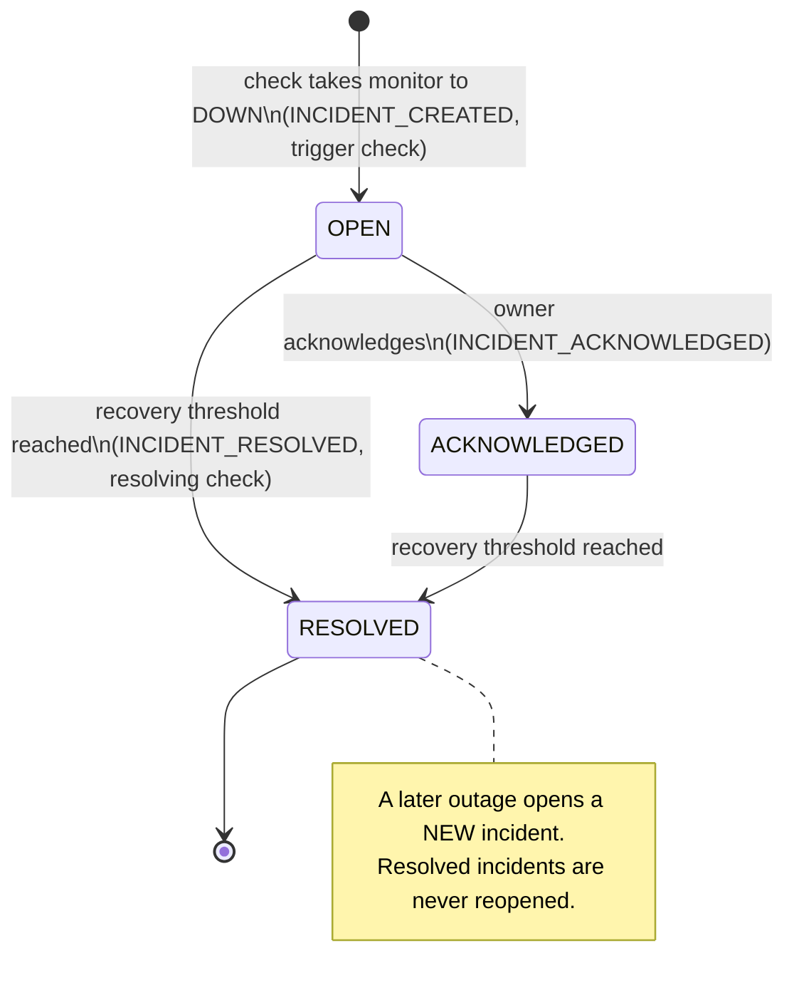

# Incident management

RAIN opens an incident automatically when a monitor goes DOWN, keeps a permanent timeline of
what happened, lets the owner acknowledge it, and resolves it automatically once the monitor has
recovered. See [monitoring-engine.md](monitoring-engine.md) for how checks and health work.

## Lifecycle



Title, description and severity can be edited in any status (`INCIDENT_UPDATED`).

### Creation

An incident opens when a recorded, health-affecting check leaves the monitor **DOWN** and the
monitor has **no active incident** (OPEN or ACKNOWLEDGED). With the default failure threshold of 2:

| Check            | Monitor  | Incident                                 |
| ---------------- | -------- | ---------------------------------------- |
| 1st failure      | DEGRADED | none                                     |
| 2nd failure      | DOWN     | **opened**, linked to this check         |
| further failures | DOWN     | unchanged (no duplicates, no new events) |

- Title: `<monitor name> is down`. Severity: **HIGH** (`DEFAULT_INCIDENT_SEVERITY`; a confirmed
  outage is serious, but RAIN can't know the business impact, so the owner can raise it to
  CRITICAL or lower it).
- Description: a generated summary (number of failed checks, failure reason, the executor's
  sanitised message, which never contains query strings, credentials, headers or bodies).
- `started_at` is the trigger check's `checked_at`; `trigger_check_id` is that check.
- A monitor that is already DOWN without an active incident (for example, state written before
  this feature existed) gets one on its next failed check.

### Resolution

An active incident resolves when a passing check (expected status, **fast or slow**) brings the
monitor's consecutive passing checks to the **recovery threshold** (default 2), the same counter
the health engine uses:

| Check after the outage | Monitor                       | Incident     |
| ---------------------- | ----------------------------- | ------------ |
| 1st pass               | DEGRADED                      | still active |
| failure                | DEGRADED (count reset)        | still active |
| 1st pass again         | DEGRADED                      | still active |
| 2nd consecutive pass   | HEALTHY (or DEGRADED if slow) | **resolved** |

The temporary DOWN → DEGRADED step after the first passing check never resolves anything. An
acknowledged incident resolves the same way. Resolution is automatic only; there is no manual
"resolve" in this phase.

### What never opens or resolves an incident

- Checks refused by RAIN itself (`BLOCKED_DESTINATION`, `CONFIGURATION_ERROR`): they don't change
  health, so they don't change incidents.
- Checks recorded while the monitor is paused. A paused monitor keeps its incident open until it
  is resumed and recovers.

## Transactions, races and crashes

Incident changes happen inside the worker's **check-completion transaction** (see
`apps/server/src/monitoring/monitoring-store.ts`), after the check row is inserted and while the
monitor row is locked (`SELECT … FOR UPDATE`):

1. lock the monitor; stale lease or deleted monitor → write nothing;
2. insert the check (`ON CONFLICT (attempt_id) DO NOTHING`; a duplicate attempt stops here);
3. lock the monitor's active incident (`FOR UPDATE`) and decide with `planIncident`
   (`monitoring/incident-rules.ts`, pure and unit tested);
4. insert the incident and its `INCIDENT_CREATED` event, or resolve it and add
   `INCIDENT_RESOLVED`;
5. update the monitor's health, schedule and lease.

Consequences:

- **Duplicate active incidents are impossible:** the row lock serialises completions per monitor,
  and the partial unique index `incidents_one_active_per_monitor_uq` (`monitor_id WHERE status <>
'RESOLVED'`) rejects a second active incident even if application logic were bypassed.
- **Duplicate persistence attempts** insert no check and therefore no incident or event. The
  partial unique index `incident_events_check_once_uq` (`incident_id, event_type, check_id`) is a
  second guard.
- **Crashes / database errors** roll back the whole transaction: no check without its incident,
  no incident without its event, no health change without both. The worker releases the lease and
  a later check (still DOWN) opens the incident.
- **Acknowledge vs. automatic resolution:** both lock the incident row; the worker locks monitor
  then incident, the API locks only the incident, so they serialise without deadlocks. An
  acknowledgement that arrives after resolution gets `409 INCIDENT_ALREADY_RESOLVED`.

## Database (migration `0005_incidents`)

`incidents`

| Column                                     | Notes                                                          |
| ------------------------------------------ | -------------------------------------------------------------- |
| `id`                                       | uuid                                                           |
| `monitor_id`                               | FK → monitors, ON DELETE CASCADE                               |
| `owner_id`                                 | FK → profiles, ON DELETE CASCADE; denormalised for owner scope |
| `title`                                    | varchar(200), not blank                                        |
| `description`                              | text ≤ 2000, nullable                                          |
| `severity`                                 | CRITICAL / HIGH / MEDIUM / LOW, default HIGH                   |
| `status`                                   | OPEN / ACKNOWLEDGED / RESOLVED                                 |
| `started_at`                               | timestamptz(3)                                                 |
| `acknowledged_at`, `acknowledged_by`       | when and who (FK → profiles, SET NULL)                         |
| `resolved_at`                              | set exactly when RESOLVED (CHECK)                              |
| `trigger_check_id`, `resolved_by_check_id` | plain uuids, **no FK** (check history can expire)              |
| `created_at`, `updated_at`                 | timestamptz(3)                                                 |

Indexes: partial unique active-per-monitor; `(owner_id, started_at desc, id desc)` for the list;
`(owner_id, status)` for counts; `(monitor_id, started_at desc)` for a monitor's history.

`incident_events` (append-only timeline)

| Column        | Notes                                                                           |
| ------------- | ------------------------------------------------------------------------------- |
| `incident_id` | FK → incidents, ON DELETE CASCADE                                               |
| `event_type`  | INCIDENT_CREATED / INCIDENT_ACKNOWLEDGED / INCIDENT_RESOLVED / INCIDENT_UPDATED |
| `actor_id`    | NULL for system events; FK → profiles, SET NULL                                 |
| `occurred_at` | timestamptz(3), UTC                                                             |
| `description` | varchar(500), generated text only                                               |
| `check_id`    | the check behind a system event, no FK                                          |

A `BEFORE UPDATE` trigger (`incident_events_append_only`) rejects every UPDATE, whoever is
connected. Rows disappear only with their incident (monitor deletion cascades). Both tables have
RLS enabled with no policies, like every other table: Supabase's public roles can't reach them;
only the API and worker (table owner) can.

Earlier migrations (0000–0004) are unchanged.

## API

All endpoints are under `/api/v1`, require a bearer token, and are owner-scoped in SQL
(`owner_id = caller`). Another user's incident is **404 `INCIDENT_NOT_FOUND`**, the same as a
missing or malformed ID. Inputs are validated with the shared Zod schemas.

| Method & path                     | Purpose                                                                                                                                                                                                      |
| --------------------------------- | ------------------------------------------------------------------------------------------------------------------------------------------------------------------------------------------------------------ |
| `GET /incidents`                  | List, newest first. `status` (OPEN, ACKNOWLEDGED, RESOLVED, ACTIVE), `severity`, `monitorId`, `limit` 1–100 (20), `cursor`. Returns `items`, `nextCursor`, `total`.                                          |
| `GET /incidents/counts`           | `{ total, open, acknowledged, resolved }`, optional `monitorId`.                                                                                                                                             |
| `GET /incidents/:id`              | One incident with its monitor (`id`, `name`, `currentStatus`, `enabled`).                                                                                                                                    |
| `GET /incidents/:id/events`       | Timeline, oldest first, `limit` 1–200 (100), `cursor`.                                                                                                                                                       |
| `POST /incidents/:id/acknowledge` | OPEN → ACKNOWLEDGED, records who/when and an event. 409 `INCIDENT_ALREADY_ACKNOWLEDGED` / `INCIDENT_ALREADY_RESOLVED`.                                                                                       |
| `PATCH /incidents/:id`            | `title`, `description` (empty → null), `severity` only (strict: any other field is 400). Records one `INCIDENT_UPDATED` event when something changed; the event says what changed but doesn't copy the text. |

Responses never include monitor URLs, headers, request bodies or database internals. Database
errors surface as the generic 500 `INTERNAL_ERROR`.

## Web app

- **Incidents** (`/app/incidents`, in the main navigation): counts (total, open, acknowledged,
  resolved), status and severity filters (kept in the URL, plus `monitorId` from monitor pages),
  incident table (title, monitor, severity, status, started, duration, acknowledgement) with
  "Load more", and loading, empty, no-match and error-with-retry states.
- **Incident details** (`/app/incidents/:id`): title, badges, description, start, duration,
  acknowledgement, resolution, the monitor's current health with a link to its page,
  **Acknowledge** (OPEN only), **Edit** (title, description, severity), and the timeline.
- **Monitor details**: an alert for the active incident with a link, and the five most recent
  incidents with "View all".
- Incident screens refresh every 30 s. All data comes from the API.

## Testing

```bash
npm test
```

- `apps/server/src/monitoring/incident-rules.test.ts`: creation/resolution rules, thresholds,
  flapping, slow responses, clipping.
- `apps/server/src/incidents/incident-lifecycle.test.ts`: end to end with the real worker,
  executor and SSRF-safe transport against a local server; rollback, duplicate attempts, stale
  workers, cascade; service rules (acknowledge, update, filters, counts, pagination, timeline,
  ownership).
- `apps/server/src/incidents/incident-routes.test.ts`: auth, validation, 404 for malformed IDs.
- `apps/web/src/features/incidents/incidents.test.tsx`: dashboard, filters, pagination, states,
  details, acknowledge, edit, monitor integration.

```bash
npm run test:integration
```

- `tests/integration/incidents.test.ts`: constraints and the partial unique indexes, the
  append-only trigger, cascades, lifecycle through the real completion SQL, rollback on a forced
  failure, duplicate attempts, concurrent completions and inserts, and the HTTP API with two users.
  Needs Docker (Testcontainers) or `TEST_DATABASE_URL` pointing at a local `*_test` database.

## Notifications

Opening and resolving an incident queue email/webhook notifications in the same transaction; see
[notifications.md](notifications.md).

## Analytics

Incident counts, frequency and resolution times are reported from these tables by the analytics
endpoints; see [metrics-and-analytics.md](metrics-and-analytics.md).

## Not in this phase

Public status pages, manual resolution, and incident
retention.
