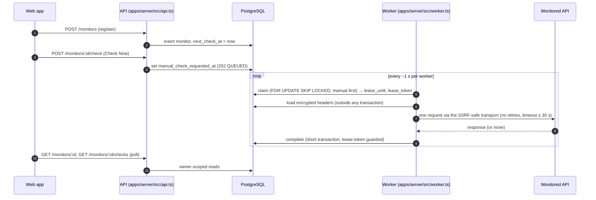

# Monitoring engine

How RAIN checks monitors: scheduling, the worker, leases, health and manual checks. Network
security (SSRF) is covered in [security/monitor-network-security.md](security/monitor-network-security.md).

## Overview

The API never sends a monitored request. It only reads and writes PostgreSQL; the worker is the
only process that talks to monitored APIs. Any number of worker processes can run at once.

## Database (migration `0004_monitoring_engine`)

Existing columns are reused (`current_status`, `consecutive_failures`, `consecutive_successes`,
`status_changed_at`, `last_checked_at`, `next_check_at`, `lease_until`). New:

| Table            | Column                      | Purpose                                                                                |
| ---------------- | --------------------------- | -------------------------------------------------------------------------------------- |
| `monitors`       | `lease_token` uuid          | Proves which claim holds the lease. CHECK: set together with `lease_until`.            |
| `monitors`       | `manual_check_requested_at` | The queued manual check (NULL when none). Partial index for the queue.                 |
| `monitors`       | `last_manual_check_at`      | When the last manual check ran; drives the 10 s cooldown.                              |
| `monitor_checks` | `source`                    | `SCHEDULED` or `MANUAL` (CHECK constraint).                                            |
| `monitor_checks` | `attempt_id` uuid, unique   | The claim's lease token. `ON CONFLICT DO NOTHING` makes completion idempotent.         |
| `monitor_checks` | `failure_reason`            | Vocabulary extended with `CONFIGURATION_ERROR` (constraint replaced in the migration). |

Older migrations are untouched. The migration clears any `lease_until` left without a token
before adding the pairing constraint.

## Worker loop

`createMonitoringWorker` (`apps/server/src/monitoring/worker-engine.ts`):

1. **Poll** every `WORKER_POLL_INTERVAL_MS` (default 1000). After a full batch it polls again
   sooner; when a slot frees up it wakes immediately.
2. **Claim** up to the free capacity (`WORKER_CONCURRENCY`, default 25) in one statement: a CTE
   selects enabled monitors with no live lease that are due or have a queued manual check,
   ordered manual first (oldest request), then most overdue, `LIMIT n FOR UPDATE SKIP LOCKED`;
   the `UPDATE` sets `lease_until = now() + WORKER_LEASE_SECONDS` and a fresh `lease_token`.
   It autocommits: no transaction stays open during checks.
3. **Execute**: load the encrypted headers, then run the executor (method policy, 32 KB request
   body, 64 KB response read, timeout ≤ 30 s, no retries, SSRF-safe transport).
4. **Complete** in one short transaction (`createMonitoringStore().complete`):
   1. `SELECT … FOR UPDATE` the monitor row;
   2. if the row is gone (deleted) or `lease_token` differs (stale worker), write nothing;
   3. insert the check with `attempt_id = lease_token`, `ON CONFLICT (attempt_id) DO NOTHING`;
   4. apply the health transition (unless paused or health-neutral, below);
   5. set `status_changed_at` only when the status changed;
   6. compute the next check;
   7. clear the lease, guarded by `WHERE lease_token = $token`.

   Between steps 3 and 4 the same transaction opens or resolves the monitor's incident (see
   [incident-management.md](incident-management.md)), so a check, its health change and its
   incident change always commit together.

The decisions in steps 2 and 4–6 are pure functions in `completion.ts`, shared by the PostgreSQL
store and the in-memory test store.

### Leases and crash semantics

- The lease (`WORKER_LEASE_SECONDS`, default 90, minimum 45) outlasts the longest request (30 s)
  plus a 15 s margin, so a live worker always completes before its lease can expire.
- If a worker crashes, its lease expires and another worker re-claims the monitor with a new
  token. The schedule and any manual request are still pending, so nothing is lost.
- A check can therefore be **executed** more than once (the crashed attempt may have sent its
  request), but each attempt is **recorded** at most once (`attempt_id` is unique) and a stale
  attempt never writes (token mismatch).
- Pausing or resuming never clears a lease, so a quick pause/resume can't let a second worker
  claim a monitor whose check is still in flight.
- Unexpected errors (database failure during completion, undecryptable data handled as below,
  outbound transport disabled) release the lease without recording a check; the schedule still
  advances and the served manual request is dropped, so a persistent fault can't cause a hot loop.
- Database outages while claiming back off exponentially (from the poll interval up to 30 s) and
  recover on their own.

### Graceful shutdown

On SIGTERM/SIGINT the worker stops claiming, waits up to `WORKER_SHUTDOWN_GRACE_MS` (default
35 s) for in-flight checks, then closes the database pool and the transport. Checks still running
after the grace period are abandoned; their leases expire and another worker re-runs them. The
process exits 0 when drained, 1 otherwise.

## Scheduling

- Next check = previous **scheduled** time + k × interval, for the smallest k ≥ 1 in the future
  (`schedule.ts`). Late checks don't drift the cadence; intervals missed while no worker ran are
  skipped, not replayed.
- Only a claim that was due advances the schedule, and only if nobody rescheduled the monitor
  meanwhile (resume sets `next_check_at = now`). Manual checks never shift the cadence.
- Paused monitors are never claimed. Resume schedules an immediate check.
- The lease prevents overlapping checks of one monitor.

## Health

Thresholds: failure 2, recovery 2 (`HEALTH_THRESHOLDS`).

| Situation                                    | Result                                    |
| -------------------------------------------- | ----------------------------------------- |
| Expected status within the latency threshold | `SUCCESS` → HEALTHY                       |
| Expected status, slower than the threshold   | `DEGRADED` (counts as passing) → DEGRADED |
| First consecutive failure                    | DEGRADED                                  |
| Second consecutive failure                   | DOWN                                      |
| First passing check while DOWN               | DEGRADED                                  |
| Second passing check                         | HEALTHY (or DEGRADED if slow)             |
| No HTTP response                             | status code and latency stored as NULL    |
| `BLOCKED_DESTINATION`, `CONFIGURATION_ERROR` | recorded; health and counters unchanged   |
| Monitor paused while its check was running   | recorded; health and counters unchanged   |

UNKNOWN stays until the first health-affecting check. PAUSED is `enabled = false` and is shown
next to the last stored status.

Executor refusals become history entries the owner can see, with no request sent: an invalid
destination is `BLOCKED_DESTINATION`; a mutating method without consent, an invalid header, an
oversized body or an undecryptable secret is `CONFIGURATION_ERROR`.

## Manual checks

`POST /api/v1/monitors/:monitorId/check` → `202 { data: { monitorId, status: "QUEUED", queuedAt } }`

| Rule                                       | Error                                |
| ------------------------------------------ | ------------------------------------ |
| Not found or not the caller's              | 404 `MONITOR_NOT_FOUND`              |
| Monitor paused                             | 409 `MONITOR_PAUSED`                 |
| A manual check already queued              | 409 `CHECK_ALREADY_QUEUED`           |
| Within 10 s of the last manual check       | 429 `CHECK_COOLDOWN` + `Retry-After` |
| Configuration the worker would refuse      | 422 `MONITOR_CONFIGURATION_INVALID`  |
| More than 20/min per user or 30/min per IP | 429 `RATE_LIMITED`                   |

The request is stored in PostgreSQL (`manual_check_requested_at`, row-locked) and served by the
next poll ahead of scheduled work, recorded with `source = MANUAL`. Pausing a monitor drops its
queued request.

## Check history

`GET /api/v1/monitors/:monitorId/checks?limit=25&source=MANUAL&cursor=…`

Owner-scoped (404 otherwise), newest first, keyset pagination on `(checked_at, id)`, `limit`
1–100 (default 25), optional `source`. Items contain only `id`, `checkedAt`, `source`, `outcome`,
`statusCode`, `latencyMs`, `failureReason` and the sanitised `errorMessage`.

## Web app

- Registry: real health badge (plus Paused), last checked and next check.
- Details: health and since when, last check result (HTTP status, latency, error), next check,
  request permission, **Check now** (queues, polls the monitor every second for up to 45 s, then
  shows the recorded result or explains that the worker may be offline), and a **History** tab
  with source filter, loading, empty and error states and "Load older checks".
- Screens showing health refresh every 30 s.

## Configuration

| Variable                                                  | Default | Notes                                      |
| --------------------------------------------------------- | ------- | ------------------------------------------ |
| `DATABASE_URL`                                            | —       | Required.                                  |
| `ENCRYPTION_KEY`, `…_VERSION`, `ENCRYPTION_PREVIOUS_KEYS` | —       | Required: headers are decrypted per check. |
| `WORKER_CONCURRENCY`                                      | 25      | 1–500 checks at once per process.          |
| `WORKER_POLL_INTERVAL_MS`                                 | 1000    | 100–60000.                                 |
| `WORKER_LEASE_SECONDS`                                    | 90      | 45–3600.                                   |
| `WORKER_SHUTDOWN_GRACE_MS`                                | 35000   | 0–120000.                                  |
| `WORKER_DB_MAX_CONNECTIONS`                               | 10      | 2–100.                                     |

Run with `npm run dev:worker` (development) or `npm run start:worker -w @rain/server` after a build.

## Tests

- Unit: `schedule.test.ts`, `completion.test.ts` (lease decisions, health, scheduling, manual
  requests), service and route tests for the endpoints, config tests.
- End-to-end without a database: `worker-engine.test.ts` runs the real service, executor and
  SSRF-safe transport against a local HTTP server through the in-memory store.
- PostgreSQL: `tests/integration/monitoring-engine.test.ts` (SKIP LOCKED, concurrent claims,
  constraints, completion transaction, idempotency, manual-check API). Needs Docker or a local
  `*_test` database via `TEST_DATABASE_URL`.

## Known limitations

- A configuration edit (URL, method, expected status) made while a check is in flight does not
  invalidate that check: its result is recorded and applied.
- At-least-once execution: after a worker crash a request may be sent twice (once unrecorded).
- Recovery threshold is limited to 1 or 2, because the stored state can't tell a longer recovery
  from normal degraded operation.
- Check history has no retention job yet.
