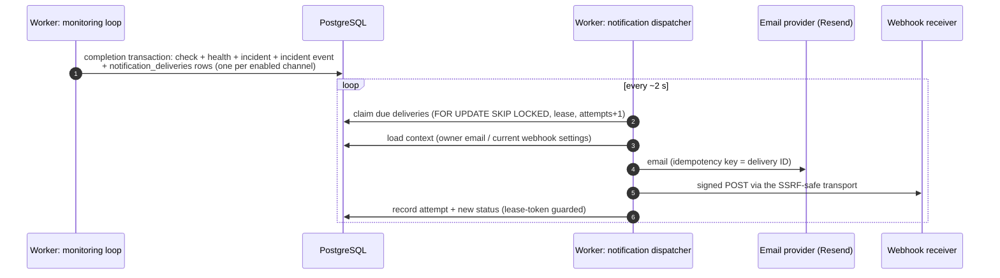

# Notifications

RAIN notifies monitor owners when an **incident opens** (`INCIDENT_CREATED`) and when it
**resolves** (`INCIDENT_RESOLVED`). It sends by email and by signed HTTP webhook.

- Individual failed checks never notify.
- Repeated failures during an open incident never notify again.

## Architecture



**Transactional outbox:**

- When the monitoring worker opens or resolves an incident, it inserts the incident event and the delivery rows in the **same transaction** as the check result (`notification-outbox.ts`).
- Nothing is sent inside that transaction.
- If the transaction rolls back, no job exists. If it commits, the jobs exist.
- `(event_id, channel)` is unique, so a duplicated or retried event can never queue a second job.

**Dispatcher:**

- It runs in the worker process on its own loop and its own concurrency (`NOTIFY_CONCURRENCY`), so slow receivers never delay monitoring.
- Several worker processes can run at once: claims use `FOR UPDATE SKIP LOCKED` and leases.

## Preferences (per monitor)

Configured on the monitor's **Notifications** tab, or through `PUT /api/v1/monitors/:id/notifications`.

| Setting | Default | Notes                                                                             |
| ------- | ------- | --------------------------------------------------------------------------------- |
| Email   | off     | Sent to the owner's account address (Supabase auth), read at queue and send time. |
| Webhook | none    | URL, enabled flag, optional authentication header, RAIN-generated signing secret. |

Nothing is queued for a channel until it is configured and enabled:

- **Email:** enabled, and the account has an address.
- **Webhook:** enabled, with a URL and a signing secret.

There is no settings row until the owner saves one.

## Event payload

Every delivery stores a safe snapshot of the event (`NotificationPayloadSchema`). It never contains:

- the monitor URL;
- request headers or bodies;
- credentials;
- query strings.

The summary is the incident's generated description, which uses the executor's sanitised error text.

```json
{
  "eventId": "6a1f…",
  "eventType": "INCIDENT_CREATED",
  "occurredAt": "2026-11-19T10:00:00.000Z",
  "incident": {
    "id": "c0de…",
    "title": "Payments is down",
    "severity": "HIGH",
    "status": "OPEN",
    "summary": "Detected automatically after 2 consecutive failed checks. Last check: unexpected HTTP status (HTTP 503). …",
    "startedAt": "2026-11-19T10:00:00.000Z",
    "resolvedAt": null
  },
  "monitor": { "id": "9b2e…", "name": "Payments" },
  "deliveryId": "51d3…"
}
```

- **The webhook body** is the snapshot plus `deliveryId`.
- **`deliveryId`** is unique per delivery and repeated on retries. Receivers should de-duplicate on it.

## Email

**Provider:**

- An `EmailProvider` interface, with a Resend adapter that calls `POST https://api.resend.com/emails` directly (no SDK dependency).
- The endpoint is fixed by RAIN, not user input. It uses its own TLS-verifying client, not the user-destination SSRF transport.

**Configuration:**

- Set **both** `RESEND_API_KEY` and `NOTIFICATION_EMAIL_FROM` (a sender on a domain verified in Resend).
- `APP_BASE_URL` is the public web app URL used for the "View incident" link.
- Without the key and sender, emails are recorded as **FAILED** with "Email delivery is not configured", never as sent.
  - The settings page tells the owner.
  - The worker logs a warning at startup.

**Content:**

- An HTML email and a plain-text email, with every value HTML-escaped.
- Fields: monitor name, incident title, severity, status, event time (UTC), safe summary, and a link to `/app/incidents/:id`.

**Idempotency:** the delivery ID is sent as Resend's `Idempotency-Key`, so retries of one delivery can't produce two emails while Resend remembers the key.

**Error handling:**

- Only a short error name (for example `validation_error`) is stored. The raw provider response never is.
- 4xx responses are permanent failures.
- 408, 429, 5xx and network errors are temporary.

## Webhooks

### Request

`POST <your URL>` with `Content-Type: application/json` and these headers:

| Header             | Value                                                            |
| ------------------ | ---------------------------------------------------------------- |
| `X-Rain-Event`     | `INCIDENT_CREATED` or `INCIDENT_RESOLVED`                        |
| `X-Rain-Delivery`  | the delivery ID (same as `deliveryId` in the body)               |
| `X-Rain-Timestamp` | Unix seconds when this attempt was signed                        |
| `X-Rain-Signature` | `v1=` + hex HMAC-SHA256(secret, `"<timestamp>.<raw body>"`)      |
| your header        | optional, e.g. `Authorization`, as configured (stored encrypted) |

**Responses:**

- **2xx:** delivered.
- **3xx:** a permanent failure. Redirects are **never** followed.
- **408, 425, 429 and 5xx:** temporary failures, retried.
- **Other 4xx:** permanent failures.
- **Response bodies** are read up to 8 KB and discarded.
- **Timeout:** 10 s.

### Verifying signatures

The signing secret (`whsec_…`) is generated by RAIN when the webhook is created or rotated.

- It is **shown once**. It is stored only encrypted (AES-256-GCM).
- It is never returned again or logged.

To verify a request:

1. Take the raw request body exactly as received, not re-serialised.
2. Compute `HMAC-SHA256(secret, timestamp + "." + body)` in hex.
3. Compare it with the `v1=` value in constant time.
4. Reject timestamps older than about 5 minutes.
5. Store `X-Rain-Delivery` values for at least that window and drop repeats (replay protection; RAIN may also redeliver).

```js
import { createHmac, timingSafeEqual } from 'node:crypto';

function verify(secret, rawBody, signature, timestamp) {
  const age = Math.abs(Date.now() / 1000 - Number(timestamp));
  if (!Number.isInteger(Number(timestamp)) || age > 300) return false;
  const expected =
    'v1=' + createHmac('sha256', secret).update(`${timestamp}.${rawBody}`).digest('hex');
  return (
    expected.length === signature.length &&
    timingSafeEqual(Buffer.from(expected), Buffer.from(signature))
  );
}
```

The same logic is in `verifyWebhookSignature` (`apps/server/src/notifications/webhook-sender.ts`).

### SSRF protection

A webhook URL is a user-chosen outbound destination, so it gets **exactly** the monitor executor's protections. Nothing is relaxed:

- **Destination rules:** `http`/`https` only, ports 80 and 443 only. No private, loopback, link-local, metadata or other restricted IP literals, no local hostnames, no credentials in the URL. Checked when saved, and again on every send.
- **DNS:** every A/AAAA answer is resolved and validated on every connection, and the whole host is refused if any answer is non-public.
- **Connection:** the socket is pinned to the validated IP, with the original hostname for SNI and certificate verification on.
- **No proxies, no redirects:** proxy settings are ignored, and redirects are never followed. A host that rebinds to a private address after being saved is refused at send time.
- **Transport check:** `createWebhookSender` refuses any dispatcher that isn't the SSRF-safe one.
- **What's stored:** only the host is ever shown or logged. The URL is stored, but errors and history show only the host.
- **Auth header rules:** the optional header follows the monitor header rules, and it can't override `X-Rain-*` or `User-Agent`.
- **Origin change:** if the webhook moves to another origin, a stored header is dropped and must be entered again. The secret is RAIN's own, so it is kept.

## Delivery, retries and failures

| Field           | Meaning                                                                               |
| --------------- | ------------------------------------------------------------------------------------- |
| `status`        | `PENDING` → `PROCESSING` (leased) → `SENT` or `FAILED`; back to `PENDING` for a retry |
| `attempts`      | Attempts made, counted **when claimed** (a crashed attempt still counts)              |
| `maxAttempts`   | 8 by default                                                                          |
| `nextAttemptAt` | When a `PENDING` delivery becomes due                                                 |
| `lastError`     | Sanitised reason: no secrets, no raw provider responses                               |

**Backoff:**

- Exponential: 30 s, 1 min, 2 min, … capped at 6 h.
- Equal jitter: the delay is between half of and the full nominal value.

**Failure classes:**

- **Temporary failures:** timeouts, connection or TLS failures, 408/425/429, 5xx. Retried until `maxAttempts`, then `FAILED` ("gave up after N attempts").
- **Permanent failures:** SSRF refusal, invalid URL, other 4xx, redirects, email not configured, account without an address, webhook removed or disabled after queueing. These go straight to `FAILED`.

**Lease recovery and crash safety:**

- A dispatcher that dies mid-attempt leaves a `PROCESSING` row. When its lease (`NOTIFY_LEASE_SECONDS`, default 60, at least 30) expires, another claim picks it up.
- If that lost attempt was the last one allowed, the row becomes `FAILED`.
- A late completion from the old holder is rejected (lease-token mismatch).
- **At-least-once:** if the worker stops after the receiver accepted a request but before the result was recorded, the delivery is sent again. RAIN does **not** claim exactly-once delivery; receivers de-duplicate on the delivery ID, and the email provider on its idempotency key.

**Manual retry:**

- `POST /api/v1/notifications/:id/retry`, for `FAILED` deliveries only.
- It grants a fresh budget of 8 attempts.
- The attempt history is kept, and attempt numbers continue.
- It uses the monitor's **current** webhook settings.

## API

All endpoints are under `/api/v1`, authenticated and owner-scoped in SQL. Another user's monitor or delivery is a 404.

| Endpoint                                 | Purpose                                                                                                                                                     |
| ---------------------------------------- | ----------------------------------------------------------------------------------------------------------------------------------------------------------- |
| `GET /monitors/:monitorId/notifications` | Settings: email (enabled, address, provider configured), webhook (URL, enabled, header name)                                                                |
| `PUT /monitors/:monitorId/notifications` | `{ emailEnabled?, webhook?: { enabled, url, header?: {name,value} \| null, rotateSecret? } \| null }`; returns `signingSecret` once when created or rotated |
| `GET /notifications`                     | History: `status`, `channel`, `monitorId`, `limit` (≤ 100), `cursor`; newest first, with `total`                                                            |
| `GET /notifications/:id`                 | One delivery with its attempt history                                                                                                                       |
| `POST /notifications/:id/retry`          | Retry a `FAILED` delivery (409 `NOTIFICATION_NOT_RETRYABLE` otherwise)                                                                                      |

Responses never include:

- encryption fields;
- the signing secret (except once, as above);
- header values;
- raw provider responses;
- leases or payload internals.

## Web app

- **Monitor details → Notifications:**
  - email toggle, with the address and a warning when the server has no email provider;
  - webhook URL, enabled toggle, optional authentication header (write-only);
  - rotate secret, remove webhook;
  - security guidance;
  - the one-time signing-secret display with Copy.
- **Notifications** (`/app/notifications`, in the main navigation):
  - delivery history: event, monitor, incident, channel and destination, status, attempts, last attempt, delivered time, safe error;
  - status and channel filters, plus `monitorId` from monitor pages;
  - "Load more";
  - loading, empty and error-with-retry states.
- **Delivery details:** the attempt table and **Retry delivery** for failed deliveries.

## Database (migration `0006_notifications`)

**`monitor_notification_settings`**, one row per monitor (cascade):

- the email flag;
- the webhook URL and enabled flag;
- the encrypted signing secret;
- the optional header name and its encrypted value.

CHECKs require a complete webhook configuration and allow enabling only a configured one.

**`notification_deliveries`** (the outbox; cascades with its monitor and incident):

- owner, monitor, incident and event IDs, event type, channel;
- the payload (jsonb), destination label and status;
- attempts and max attempts, next attempt time, lease token and lease expiry;
- last attempt time, delivered time, sanitised last error, and timestamps.

Constraints and indexes:

- unique `(event_id, channel)`;
- partial indexes for due `PENDING` rows and leased `PROCESSING` rows;
- a keyset index for the owner's history;
- CHECKs on the vocabularies, status/lease consistency and `SENT` ⇔ `delivered_at`.

**`notification_attempts`**:

- one row per attempt: number, start and finish times, outcome, HTTP status, sanitised error;
- unique `(delivery_id, attempt_number)`.

All three tables have RLS enabled with no policies, like every other table. Earlier migrations are unchanged.

## Environment variables

| Variable                  | Required  | Default                 | Notes                                        |
| ------------------------- | --------- | ----------------------- | -------------------------------------------- |
| `RESEND_API_KEY`          | for email | –                       | Server-side only (API and worker)            |
| `NOTIFICATION_EMAIL_FROM` | for email | –                       | e.g. `RAIN <alerts@your-domain.com>`         |
| `APP_BASE_URL`            | worker    | `http://localhost:5173` | Link target in emails                        |
| `NOTIFY_CONCURRENCY`      | no        | 10                      | 1–100 parallel deliveries per worker         |
| `NOTIFY_POLL_INTERVAL_MS` | no        | 2000                    | 200–60000                                    |
| `NOTIFY_LEASE_SECONDS`    | no        | 60                      | 30–3600 (longer than the 15 s email timeout) |

## Testing

```bash
npm test
```

| Test file                                                    | What it covers                                                                                                                                                                                                                                                                                                                                                                                                                  |
| ------------------------------------------------------------ | ------------------------------------------------------------------------------------------------------------------------------------------------------------------------------------------------------------------------------------------------------------------------------------------------------------------------------------------------------------------------------------------------------------------------------- |
| `notification-rules.test.ts`                                 | Channel planning, masking, backoff and jitter bounds, HTTP classification, retry decisions.                                                                                                                                                                                                                                                                                                                                     |
| `webhook-sender.test.ts`                                     | The real SSRF-safe transport against a local server: signed requests and verification, status classes, no redirects, private and mixed DNS answers, rebinding between deliveries, refused URLs, timeouts, connection failures, forbidden headers, non-safe transports.                                                                                                                                                          |
| `email.test.ts`                                              | Rendering (escaping, link, wording) and the Resend adapter against undici's `MockAgent`: success with idempotency key, permanent and temporary errors, unconfigured provider.                                                                                                                                                                                                                                                   |
| `notifications.test.ts`                                      | Incident creation and resolution queue jobs; repeats, duplicate attempts and disabled channels queue none; rollback; dispatcher delivery, backoff to `FAILED`, permanent failures, SSRF, lease expiry and stale completion, exhausted leases, removed webhooks, unconfigured email, database errors and drain; settings (secret shown once, encrypted, rotation, header origin rule, removal); history, owner isolation, retry. |
| `notification-routes.test.ts`                                | Auth, validation (unsafe URLs, forged `X-Rain-*` header, unknown fields), 404s.                                                                                                                                                                                                                                                                                                                                                 |
| `apps/web/src/features/notifications/notifications.test.tsx` | Settings tab, one-time secret, validation display, rotate and remove, history list, filters, states, details and retry.                                                                                                                                                                                                                                                                                                         |

No real email or webhook is ever sent: a recording provider, undici's `MockAgent`, and local servers behind the safe transport.

```bash
npm run test:integration
```

`tests/integration/notifications.test.ts` covers the outbox in the real completion SQL, uniqueness, CHECKs, encryption at rest, `SKIP LOCKED` claims across two connections, lease recovery, retry scheduling, and the API with two users. It needs Docker or `TEST_DATABASE_URL`.

## Known limitations

- **No other channels:** no Slack or SMS, no digest or quiet hours, no per-severity routing (later phases).
- **Settings changes after queueing:** email goes to the current account address. Webhooks use the current settings at send time, so a webhook disabled after queueing fails the delivery instead of sending it.
- **No retention** for delivery history.
- **Resend idempotency keys** are honoured for a limited time; a manual retry days later can send a second email.
